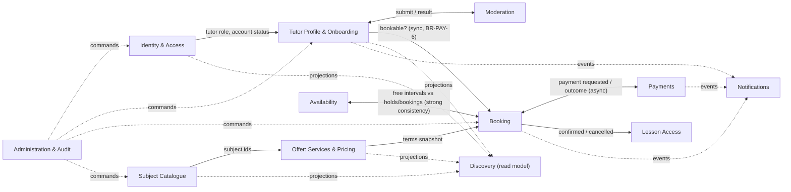
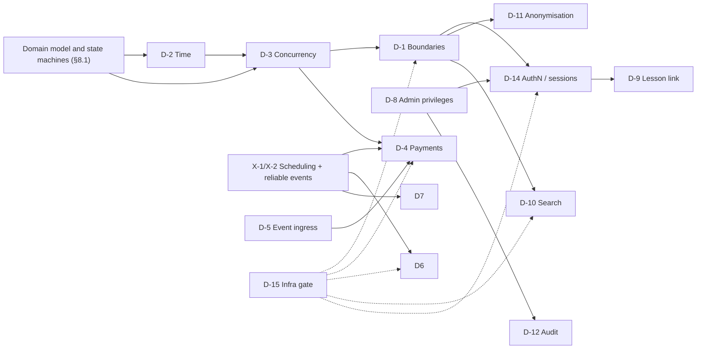

# MentorLink – Architecture Discovery

> **Status:** **accepted by the owner on 2026-11-12** (direction, preliminary domains, design order). G-1…G-12 resolved (§5.2). D-1…D-15 and X-1…X-8 remain **open**. Next stage: Domain Modeling ([`domain-model.md`](domain-model.md)). Change history in §10.
> This document **does not define the target architecture and makes no technical decisions.** Where options are listed, they are alternatives to be decided in ADRs (§6), not recommendations already adopted. It adds no business requirements: every requirement referenced here comes from [`product-vision.md`](product-vision.md).

**Sources**

| Source | Role | Currency |
|---|---|---|
| [`product-vision.md`](product-vision.md) | Approved business requirements (`BR-*`), engineering constraints (`EC-*`), assumptions (`A-*`), deferred decisions (`D-*`) | Discovery closed 2026-11-12 |
| [`review/2026-11-11-mentorlink-codebase-architecture.html`](review/2026-11-11-mentorlink-codebase-architecture.html) | Current-state architecture review | Commit `25c56f1` |
| [`../code-map.md`](../code-map.md) | Code map, flows, data model, risks (`CM-R1`…`CM-R13` below = its §8 risks) | Commit `25c56f1` |
| Repository | Verified: `HEAD` is still `25c56f1`; no code has changed since both documents were produced | 2026-11-12 |

**Use of the `/architect-design-review` skill.** The skill reviews an *approved design spec* (pre-implementation) and produces an HTML report. No target design exists yet, and the product vision is a requirements document, not a design. Running it now would evaluate the wrong artefact. It is the right tool **after** the first target-architecture draft (see §9, step 7). The codebase-level counterpart (`architect-codebase-review`) already ran on 2026-11-11 against the current commit, so it was not repeated.

---

## 1. Current state (AS-IS)

### 1.1 Summary

MentorLink today is an early-stage, small codebase (~2.7k lines of Java, ~1.3k lines of TS/TSX) consisting of three deployables:

| Deployable | Responsibility today | Data |
|---|---|---|
| **auth-service** (Spring Boot 4, Java 21) | Register, log in, issue HS256 JWT + refresh token as `HttpOnly` cookies | `auth_db`: `users`, `refresh_tokens` |
| **mentorlink-backend** (Spring Boot 4, Java 21) | Tutor profiles (bio only), subject catalogue; OAuth2 resource server validating JWTs | `tutor_db`: `tutor_profiles`, `subjects` |
| **mentorlink-frontend** (Next.js 16, React 19) | Public tutor browsing only | — |

One PostgreSQL 17 instance holds both databases. Deployment: Forgejo Actions → Forgejo registry → Coolify (one host, LAN only). Diagrams of the current state are in the code map (§2–§4) and the review report; they are not duplicated here.

### 1.2 Coverage against the MVP journey (BR-SCOPE-1)

| MVP capability | Current state |
|---|---|
| Registration / login | Backend endpoints exist; **no UI**; tokens unusable by the backend (CM-R1) |
| Roles Student + Tutor on one account (BR-ID-1, BR-ID-2) | **Not supported.** One `role` enum per user, always `STUDENT`; no role change path (CM-R3) |
| Administrator provisioning (BR-ID-6, BR-ADM-4) | **None** (CM-R3) |
| Account status / suspension (BR-ID-7) | `status` column exists, **ignored at login** (CM-R4) |
| Age confirmation (BR-PRIV-5) | Not captured |
| Tutor profile (BR-ID-4, BR-ID-13) | `bio` + `active` flag only; no versions, no moderation, no completeness, no time zone |
| Moderation (BR-MOD-*) | None |
| Subject catalogue (BR-DISC-2) | Create + list; admin-only create unreachable from UI |
| Services and pricing (BR-AVAIL-1, BR-AVAIL-7, BR-PRICE-*) | None |
| Availability, buffer, exceptions, time zones (BR-AVAIL-*, BR-TZ-*) | None |
| Holds, bookings, cancellation (BR-BOOK-*, BR-PAY-1..3, BR-CANCEL-*) | None |
| Payments, refunds (BR-PAY-*) | None |
| Lesson page (BR-MEET-*) | None |
| Discovery: filter, text search, sort, paging (BR-DISC-1) | `findAll()` listing only, no paging; frontend/backend contract mismatch crashes the list (CM-R2) |
| Notifications in-app + e-mail (BR-NOTIF-*) | None |
| Admin operations + audit (BR-ADM-*) | None |
| Account deletion / anonymisation (BR-PRIV-1..3) | None |
| Scheduled / time-driven processing | **None** (no jobs, no messaging listeners) |
| Observability | Actuator health only; **no application logging** |

**Conclusion:** the existing implementation covers roughly the identity skeleton and a thin slice of the marketplace catalogue. The core of the MVP (BR-SCOPE-5: booking correctness and payments) is **greenfield**. All environments hold test data only (BR-PRIV-7, A-5), so **data migration cost is near zero**: schema and model changes are cheap now.

### 1.3 Structural observations relevant to target design

1. **The split follows a business line** (identity vs tutoring catalogue), not a technical layer. Database-per-service and absence of synchronous service-to-service calls are already in place.
2. **Coupling between the services is narrow but hidden**: a shared HS256 secret and an undocumented `role` claim contract duplicated as two enums (review: "distributed-monolith coupling").
3. **The "Tutor" concept straddles both services**: role in identity, profile in catalogue, display name in identity. No owner of the joined read model exists (root cause of CM-R2). This foreshadows the cross-context data problems the MVP will multiply (display names in bookings, notifications, admin views, anonymisation).
4. **Inside each service** the layering is clean (controller → service → repository, mappers, DTO records, `CurrentUserProvider` seam). Domain behaviour is anaemic; acceptable today, insufficient for booking rules.
5. **Test fidelity is low for what is coming**: tests run on H2 with Flyway disabled, so PostgreSQL-specific behaviour (constraints, locking, range types, time zone handling) is never tested. Time is read via `Instant.now()` without an injectable clock.
6. **Deployment is defined twice** (CI images + webhooks vs `docker-compose.coolify.yml` with `build:`), with conflicting build-time values (CM-R13). Live Coolify facts are still `open` (code map §9).

---

## 2. Requirements and constraints that drive the architecture

Only requirements with architectural consequences are listed. The "Consequence" column states *what must be decided*, not how.

### 2.1 Architecturally significant business requirements

| Driver | Requirements | Architectural consequence |
|---|---|---|
| **Strong consistency of time allocation** | BR-AVAIL-3, BR-AVAIL-4, BR-PAY-1, BR-PAY-2, BR-PAY-7, BR-BOOK-4 | Holds and bookings (including buffers) must be checked for overlap and allocated **atomically per tutor**. "One active hold per student" is a second, cross-tutor invariant. The confirm-or-refund decision must be serialised against concurrent holds. This sets the **consistency boundary** that D-1 and D-3 must respect. |
| **Asynchronous, unreliable payment outcomes** | BR-PAY-5, BR-PAY-6, BR-PAY-8, BR-PAY-9, BR-PAY-10, BR-BOOK-3 | Payment results arrive after arbitrary delay, possibly duplicated, out of order, after hold expiry, or several per hold. Requires idempotent processing, a payment state model independent of the hold state, and automatic compensating refunds. |
| **Time-driven state transitions** | BR-BOOK-3 (hold expiry), BR-NOTIF-2 (24 h reminder), BR-CANCEL-7 (→ "completed"), BR-MOD-2 (simulated delay), BR-PAY-8 | The system needs a reliable mechanism for actions at a future time that survives restarts. None exists today. Not explicitly covered by a single D-item (see §5.3). |
| **Time zone and DST correctness** | BR-TZ-1..10, BR-AVAIL-5, BR-AVAIL-6, BR-CANCEL-1/2 | Two time semantics coexist: *recurring local wall-clock rules* (schedule) and *fixed instants* (bookings, holds, thresholds). Slot generation must handle gaps and overlaps for any IANA zone. |
| **Immutable booked terms / versioning** | BR-PRICE-4..7, BR-MOD-7, BR-ID-13 | Snapshots of service terms at hold creation; published vs pending profile versions; withdrawn-but-retained services. Data model must separate "current offer" from "historical commitment". |
| **Independent profile state dimensions** | BR-ID-3, BR-ID-5, BR-ID-9, BR-ID-10, BR-ID-13, BR-MOD-4 | Role ≠ profile status ≠ visibility ≠ moderation status. "Bookable" is a derived predicate needed **synchronously** at hold creation and at late-payment confirmation (BR-PAY-6). |
| **Non-blocking side effects** | BR-NOTIF-4, BR-MOD-3 | Notifications must not roll back business operations, yet must not be silently lost for business-relevant events. |
| **Access derived from a booking relationship** | BR-MEET-2, BR-MEET-3, BR-MEET-6, §15 (chat, files: level B) | Authorisation is not only role-based: it depends on domain state (confirmed booking, participant). Must be checked per request. The same principle is expected to extend to chat and files. |
| **Privileged operations and audit** | BR-ADM-1..4, BR-ID-6 | Hierarchy of admin privileges; mandatory reason; who/what/when/why for every admin action. |
| **Privacy across data owners** | BR-PRIV-1..4, BR-ADM-2 | Deletion preconditions span identity, booking and payment state; anonymisation must keep history consistent in **every** store that holds personal data. The more data owners, the harder (D-11). |
| **Webhook reachability in a non-public environment** | BR-ENV-1, A-1, EC-4 | The payment provider must reach (or be polled by) the system without exposing the whole application. |
| **Discovery** | BR-DISC-1..4 | Filter by subject + price range, text search on name and bio, sort, paging, visible tutors only, published version only. Combines data from identity (name), profile (bio, version) and offer (price, subjects). |

### 2.2 Engineering constraints

| Constraint | Source | Effect on design |
|---|---|---|
| Maintainability by one developer **beats** distribution | EC-1 | Every service, broker, datastore or async hop must be justified by a requirement, not by portfolio appeal. |
| Current split is not binding | EC-2, §9 | Keep / merge / rebuild auth-service and backend is an open decision (D-1). Evolution preferred over rewrite. |
| Quality priority order | EC-3 | Booking/payment correctness → security → maintainability/testability → observability → evolvability → scalability. Scalability is **last**: it cannot justify complexity by itself. |
| One host, Coolify + Forgejo, zero budget | EC-4 | Memory/CPU of every component counts. Free tiers and test modes only. |
| Each new infra component needs an ADR | EC-4, D-15 | Applies to brokers, caches, search engines, IdPs, tunnels, mail catchers. |
| Readiness levels A/B/C | EC-5, §15 | Level A: leave room (extension points). Level B (chat, files): consider in boundaries only. Level C (group lessons, courses, subscriptions): booking stays **1:1**, later rebuild accepted. |
| Security as if real personal data | BR-PRIV-7, A-5 | Security controls are not relaxed because data is fake. |
| Later public deployment must remain possible | BR-ENV-2 | TLS, single entry point, configurable origins/cookies must not be precluded. |

### 2.3 Future capabilities to *not preclude* (level A) – design hooks only

Real payouts/settlements, partial refunds, multiple currencies, real moderation, real video provider behind the same lesson page, atomic reschedule, optional tutor approval, reviews (one per completed booking), data export, public deployment. Each of these is a check during design ("does the chosen model block this?"), not a feature to build.

---

## 3. Business domains – preliminary identification

> Capability areas derived from product-vision §4 and §12. **These are not service or module boundaries.** Boundaries are D-1, decided after the consistency analysis in §8.

### 3.1 Candidate domains

| # | Domain (working name) | Responsibilities (MVP) | Key concepts | Key invariants / rules | Type (preliminary) |
|---|---|---|---|---|---|
| 1 | **Identity & Access** | Registration (18+ confirmation), authentication, sessions, roles (Student, Tutor, Administrator), admin privilege levels, account status (suspension), account deletion trigger | Account, Credential, Role grant, Session | BR-ID-1, -2, -6, BR-ADM-4, BR-PRIV-5 | Generic / supporting |
| 2 | **Tutor Profile & Onboarding** | Profile content, versions (published vs pending), completeness, self-pause, admin hide/suspend, visibility predicate | Tutor profile, Profile version, Visibility | BR-ID-3..5, -9, -10, -13, BR-MOD-7 | Supporting / core-adjacent |
| 3 | **Moderation** | Submission, (simulated) review process, result | Moderation case, Result | BR-MOD-1..6; process separate from profile status | Supporting (replaceable by design, BR-MOD-4) |
| 4 | **Offer (Services & Pricing)** | Service definition, limits, withdrawal, subject assignment | Service, Price (amount + currency), Duration | BR-AVAIL-1, -7, BR-PRICE-1, -2, -6 | Supporting |
| 5 | **Subject Catalogue** | Admin-managed subjects | Subject | BR-DISC-2 | Generic |
| 6 | **Availability (Schedule)** | Weekly schedule in tutor local time, exceptions, buffer, tutor time zone, start-time computation | Weekly rule, Exception, Buffer, Time zone | BR-AVAIL-2..6, BR-TZ-*, BR-PRICE-7, -8 | **Core** |
| 7 | **Booking** | Holds, booking lifecycle, cancellation rules, "completed" transition, terms snapshot, confirm-or-refund decision | Hold, Booking, Terms snapshot, Cancellation | BR-BOOK-*, BR-PAY-1..3, -6, -7, -10, BR-PRICE-4, -5, BR-CANCEL-* | **Core** |
| 8 | **Payments** | Payment attempts, provider integration, outcome handling, refunds, transaction history | Payment, Payment attempt, Refund, Provider event | BR-PAY-4, -5, -8, -9, -10, BR-CANCEL-6, BR-SCOPE-3 | **Core** (correctness-critical), integration-heavy |
| 9 | **Lesson Access** | Per-booking unique link, lesson page, per-visit access check, demo video placeholder | Lesson, Meeting link | BR-MEET-1..7 | Supporting |
| 10 | **Discovery** | Search/filter/sort/paging over visible tutors' published data | Tutor listing (read model) | BR-DISC-1, -3, -4 | Supporting, **read model** across 1, 2, 4, 5 |
| 11 | **Notifications** | In-app + e-mail delivery, reminders, recipient time zone formatting | Notification, Channel, Template | BR-NOTIF-*, BR-TZ-9 | Generic |
| 12 | **Administration & Audit** | Admin use cases across domains, audit trail with mandatory reason | Admin action, Audit entry | BR-ADM-*, BR-ID-7, -8 | Supporting, cross-cutting |
| 13 | **Privacy (account lifecycle)** | Deletion preconditions, anonymisation coordination | Deletion request | BR-PRIV-1..4 | Cross-cutting process |

Level-B domains to be *considered in boundaries* only: **Communication** (chat) and **Files & Materials**. Both are expected to authorise on the booking relationship (§15 of the vision), which makes Booking (or a "relationship" concept derived from it) **upstream** of them.

### 3.2 Preliminary relationships

Solid arrows = data or decisions needed for a business rule. Dashed = read models or side effects. The double arrow between **Availability** and **Booking** marks the tightest consistency requirement in the system: free time is *computed from* holds and bookings (BR-AVAIL-2), and allocation must be atomic (BR-PAY-7). Whether these two are one domain model or two with a shared consistency mechanism is an open question (§8.1).

### 3.3 Observations

- **Identity is the most "generic"** domain and the one most often solved by off-the-shelf products. It is also the only one with existing, partially working code.
- **Availability + Booking + the decision part of Payments** form the correctness core (EC-3 priority 1). Splitting them across process or database boundaries would turn a local transaction into a distributed coordination problem.
- **Tutor** remains a multi-context concept: role (Identity), profile and visibility (Tutor Profile), offer (Offer), schedule (Availability). Ownership of the *display name* is unresolved today (CM-R2) and becomes broader with BR-PRIV-4 (display names only) and BR-PRIV-2 (anonymisation).
- **Administration** is a set of use cases in other domains plus a common audit concern, not necessarily a domain with its own data.

---

## 4. What to keep and what to reconsider

Classification: **Keep** = carry forward as is or with small fixes; **Evolve** = keep the idea, change the implementation; **Reconsider** = subject to an open decision, may be replaced.

### 4.1 Keep

| Element | Why |
|---|---|
| Java 21 + Spring Boot, Next.js + React Query | Fits the problem; no requirement argues for a change; continuity (§9). |
| Flyway migrations, `ddl-auto: validate`, `open-in-view: false` | Explicit schema ownership; safe defaults. |
| Principle of **explicit data ownership** (one writer per table, no cross-database FKs) | Directly required by §7 and §8 of the vision, whatever the deployment topology. |
| Layering controller → service → repository, DTO records, mappers | Clean, testable; keeps API separate from persistence. |
| `CurrentUserProvider` seam | Good pattern for decoupling domain logic from the security mechanism. |
| Common `ApiError` shape | One consistent error contract. |
| BCrypt passwords; refresh tokens as 256-bit random values stored hashed; `HttpOnly` cookies | Correct security primitives regardless of D-14 outcome. |
| Stateless request handling | No server session state to migrate. |
| Per-deployable CI, SHA-tagged images, multi-stage non-root Dockerfiles, Coolify/Forgejo | Matches EC-4. |

### 4.2 Evolve

| Element | Problem | Direction (not a decision) |
|---|---|---|
| User / role model | One `role` enum per user, fixed at registration (CM-R3) | Must support multiple roles per account, self-activated Tutor role, privileged admin grants (BR-ID-1, -2, -6, BR-ADM-4). Model choice is D-8/D-14. |
| Account status | Ignored at login (CM-R4) | Suspension must be effective (BR-ID-7). |
| Tutor profile | `bio` + single `active` boolean | Needs versions, moderation status, completeness and three independent dimensions (BR-ID-13). Essentially a new model; the existing table is a placeholder. |
| Subject catalogue | Normalisation bugs, unhandled races (CM-R8), no pagination | Small fixes; keep the concept. |
| Token issuance | `AuthService` fused with cookie writing / servlet API | Token transport must be replaceable (input to D-14). |
| Time handling | `Instant.now()` calls; `refresh_tokens` uses `TIMESTAMP` (CM-R9) | An injectable clock and a consistent time representation are prerequisites for testing BR-TZ-* and hold expiry (D-2). |
| Test infrastructure | H2, Flyway disabled; no cross-service or contract tests | Booking correctness will rely on PostgreSQL semantics; tests must run against the real database engine (to be decided with D-3). |
| Frontend API layer | Hand-written types drifted from backend (CM-R2) | A contract-checking approach is needed before the API grows. |
| Observability | No logs | Payment and booking flows are not debuggable without correlation and structured logs (EC-3 priority 4). |
| Deployment definition | Two definitions, conflicting build args (CM-R13), all ports published | One definition; one entry point (BR-ENV-2 compatibility). |

### 4.3 Reconsider (subject to ADRs)

| Element | Why it is open | ADR |
|---|---|---|
| **auth-service / backend split** | Boundary is defensible (identity vs domain), but its cost (shared-secret coupling, cross-context display name, separate pipelines) must be weighed against EC-1. Alternatives in §6, D-1. | D-1, D-14 |
| **Self-built authentication** vs an identity product | Own code is small but incomplete (no refresh, logout, status, roles, provisioning). An off-the-shelf IdP is another infrastructure component on one host. | D-14, D-15 |
| **Shared HS256 secret** | Any holder can mint tokens; only meaningful if services stay separate. | D-14 |
| **Token transport** (cookies issued, Bearer expected) | Currently broken end to end (CM-R1); the fix depends on origin topology and session model. | D-14 |
| **Database topology** (one instance, two DBs, one DB user) | Database-per-service not enforced by credentials; the right number of databases/schemas follows D-1. | D-1, D-15 |
| **Next.js rewrite as the only gateway** | Build-time `rewrites()`; no route to auth-service. Whether the frontend server acts as BFF, or a reverse proxy fronts everything, is open. | D-14 (+ deployment, see §5.3) |

---

## 5. Contradictions, gaps and ambiguities in the materials

> Per instructions, Product Discovery is **not reopened** and no requirements are added. Items in §5.2 are *interpretation questions*: the design needs an answer, and the owner can either confirm the interpretation proposed here or answer briefly. Where no answer is given, the proposed interpretation will be recorded as an assumption in the relevant ADR.

### 5.1 Contradictions between documents

| # | Contradiction | Where | Impact |
|---|---|---|---|
| C-1 | README: "backend (auth + tutor/subject domain) is functional and tested", frontend talks to both services | `README.md` vs code map §2, CM-R1, CM-R2 | Documentation only; README is stale. |
| C-2 | README frames the project as "a small set of independent services rather than one monolith" to practise service boundaries | `README.md` vs EC-1, EC-2 | README pre-dates EC-1. The vision prevails; README should be aligned once D-1 is decided. |
| C-3 | Vision §3, §4.7: integrated video conferencing; MVP excludes it | product-vision §3 vs BR-SCOPE-4 | Not a real conflict (§1–11 long-term vs §12 MVP, stated in the header). Noted so the lesson page is designed as the stable seam (BR-MEET-7). |
| C-4 | Vision §8 lists microservices, async communication, distributed tracing; EC-1 prioritises one-developer maintainability | product-vision §8 vs §13 | Resolved by the vision itself (EC-1, "where justified"). Every distributed pattern must cite a requirement. |
| C-5 | Code map §9.3 and the review recommend concrete solutions (JWKS, single origin, cookie resolver, display-name snapshot) | review, code map vs §16 | These are **inputs**, not decisions. They assume the current split survives, which EC-2 explicitly leaves open. Treated as options under D-14/D-1. |

### 5.2 Gaps and ambiguities affecting design – **resolved 2026-11-12**

> The owner answered G-1…G-12 on 2026-11-12. The answers are **design clarifications**: they interpret existing `BR-*` and are referenced as `G-n` in ADRs and the domain model. They are **not** new business requirements, and `product-vision.md` stays unchanged.
> The "Proposed interpretation" column keeps the original proposal from this document's first version, to preserve the history of how each clarification was reached.

| # | Question | Requirements involved | Proposed interpretation (v1, 2026-11-12) | **Resolution (owner, 2026-11-12)** | Change vs proposal |
|---|---|---|---|---|---|
| G-1 | Which tutor data is subject to moderation and versioning? | BR-ID-4, BR-ID-13, BR-MOD-1, BR-MOD-7, BR-ID-12 | Moderated, versioned content = profile text (bio, display name, subject assignment?); services, prices, schedule are operational. Service descriptions ambiguous. | **Bio and tutor display name** are moderated and versioned. Services, prices and schedule are operational data with no moderation. Service descriptions fall under the content policy (BR-ID-12) but have **no separate moderation process** in the MVP. | Narrowed: subject assignment is *not* moderated content; service descriptions settled. |
| G-2 | Is completeness evaluated on the published version or on live operational data? | BR-ID-4, BR-ID-5, BR-ID-13, BR-MOD-3 | Continuous re-evaluation on live data. | **Confirmed.** Completeness is evaluated on current operational data; losing completeness removes visibility and bookability. | — |
| G-3 | Effect of suspending a user | BR-ID-7, BR-ADM-1 | Cannot log in; bookings untouched; holds expire normally. | Suspension **blocks new actions that require an active account**; it does **not** cancel existing bookings; active holds expire normally. It must **not be assumed** that a suspended user loses access to existing paid lessons: this case **must be handled in the authorisation model**. | Changed: "cannot log in" is **not** adopted. Access of suspended users to existing lessons is an explicit authorisation-model item (D-9, D-14). |
| G-4 | Lifting a user suspension | BR-ID-10, BR-ADM-1 | Inverse admin operation, audited. | **Confirmed.** An administrator may lift a user suspension; the operation is audited (BR-ADM-3). | — |
| G-5 | Notification on admin-initiated cancellation | BR-NOTIF-2, BR-ID-8 | Student gets "refund issued"; tutor unspecified. | **Both student and tutor are notified**; the student also receives the refund information. | Extended: tutor is notified. |
| G-6 | Display name ownership and moderation | BR-PRIV-4, BR-DISC-1, BR-PRIV-2 | One display name per account; tutor's is moderated. | **Confirmed.** One display name per account. The tutor's display name is part of the moderated profile version; the student's is not moderated. Users see only display names, never e-mail addresses. | — |
| G-7 | Dev/test provisioning mechanism | BR-ID-6 | Design item under D-8 (environment-gated). | **Confirmed.** Administrators are provisioned only in a controlled dev/test environment or by a suitably privileged administrator. Mechanism remains D-8. | — |
| G-8 | Booking status model | BR-CANCEL-7, BR-PAY-8 | Defined as state machines in domain design; no new statuses. | **Confirmed.** State machines are defined during domain modelling; **no new business behaviour** that does not follow from `BR-*`. | — |
| G-9 | 24-hour cancellation boundary | BR-CANCEL-1/2 | Inclusive; evaluated against the booking's fixed instant. | **Confirmed.** Inclusive: cancelling exactly 24 h before the start gives a full refund. | — |
| G-10 | Can an Administrator also hold Student/Tutor roles? | BR-ID-1, BR-ID-6, BR-MEET-2 | Not stated. | **Yes.** Administrative privileges are independent of the Student and Tutor roles. An administrator still has **no access to lesson links** in the MVP *as an administrator*. | Resolved. |
| G-11 | "Unresolved payments" as a deletion blocker | BR-PRIV-1, BR-PAY-8 | Verifying payments and pending refunds block deletion. | **Confirmed.** | — |
| G-12 | Tutor-side deletion with future bookings | BR-PRIV-1, BR-CANCEL-3 | Tutor cancels first; students get full refunds. | **Confirmed**, under the tutor-cancellation rules (BR-CANCEL-3). | — |

**Follow-ups created by the resolutions**

- G-3 → the authorisation model must define what a suspended user may still do for existing bookings (lesson page, cancellation, viewing). Tracked in D-9 and D-14; no rule is assumed until then.
- G-10 → for a user who is both administrator and participant, lesson-link access derives from participation (BR-MEET-2), never from the administrator privilege.

### 5.3 Architectural concerns not covered by D-1…D-15

The D-list covers business-driven decisions well. These cross-cutting concerns have no D-number yet, and each needs either an ADR or explicit inclusion in an existing one:

| # | Concern | Why it matters | Suggested placement |
|---|---|---|---|
| X-1 | **Time-driven processing / scheduling** (hold expiry, 24 h reminder, "completed" transition, moderation delay) | Correctness after restarts; one mechanism should serve all cases | Part of D-3 (expiry) + D-6 (reminders), or a separate ADR |
| X-2 | **Reliable publication of domain events / side effects** (notifications, moderation, payment → booking) | BR-NOTIF-4 forbids blocking; losing the event is still a defect | Separate ADR, shared by D-4, D-6, D-7 |
| X-3 | **Edge / entry point and origin topology** (single origin, reverse proxy, BFF) | Prerequisite for D-14 cookie decisions and BR-ENV-2 | Part of D-14, or separate |
| X-4 | **API contract strategy** (OpenAPI-first vs code-first, frontend type generation, versioning) | CM-R2 already happened once | Separate ADR |
| X-5 | **Observability baseline** (structured logs, correlation IDs, metrics, tracing only if justified) | EC-3 priority 4; payment debugging | Separate ADR; tracing only if D-1 yields multiple services |
| X-6 | **Test strategy** (real-DB integration tests, clock control, concurrency tests, contract tests) | Booking correctness is untestable otherwise | Separate ADR, coupled to D-2/D-3 |
| X-7 | **Deployment definition, backups, secrets** | Two deployment definitions today; no backups; secret ownership unknown | Part of D-15 or separate |
| X-8 | **Migration path from the current implementation** | §9 / principle 8 of the vision | Section in the target architecture document |

---

## 6. Decisions D-1 … D-15

Format: the question, realistic alternatives, decisive criteria, dependencies. **No option is selected here.** Where one option looks favoured by the constraints, this is noted as an *observation* to be tested in the ADR, not a decision.

### D-1 – Domain and service boundaries

**Question:** How are the domains of §3 grouped into modules, deployables and databases? What happens to the auth-service/backend split?

| Option | Description | For | Against |
|---|---|---|---|
| A | **Modular monolith** (one deployable, explicit modules with enforced boundaries, possibly schema-per-module), auth merged in | Local transactions for the correctness core; one pipeline; lowest ops cost (EC-1, EC-4) | Boundaries must be enforced by tooling (e.g., module/arch tests), otherwise erode; less "distributed" portfolio surface |
| B | **Separate identity service + modular monolith for the domain** (evolution of today) | Keeps working code and the existing natural seam; identity is generic and stable | Cross-context data (display names, suspension, deletion) needs sync/async integration; token contract between services |
| C | **Off-the-shelf IdP + modular monolith** | Removes self-built auth and its gaps | Heavy component on one host; config-as-code effort; D-15 justification needed |
| D | **Multiple domain services** (e.g., booking, payments, profile separately) | Maximum independent deployability | Booking/availability/payment consistency becomes distributed (sagas); clashes with EC-1 and EC-3 priority 1 unless the core stays together |

**Criteria:** EC-3 order; consistency boundary from §2.1; EC-1/EC-4 operational cost; D-11 (fewer data owners = simpler anonymisation); migration path (§9).
**Depends on:** consistency analysis (§8.1), D-3 conceptual design. **Influences:** almost everything else.
**Observation:** whatever the grouping, Availability + Booking + the payment-outcome decision appear to need one transactional boundary.

### D-2 – Dates, times and time zones

**Question:** How are recurring local schedules, fixed instants, durations and zone rules represented, stored and computed?

| Option | Description | Trade-off |
|---|---|---|
| A | Schedule rules in local time + IANA zone id; bookings as UTC instants; slot expansion in application code per date | Clear separation of the two time semantics; all DST logic in tested domain code |
| B | As A, plus materialised availability intervals (pre-expanded per date for the 8-week horizon) | Faster queries/conflict checks; must be regenerated on rule changes (BR-PRICE-7) and on tz-database updates |
| C | Store local datetime + zone for bookings too | Closer to user's view, but contradicts BR-TZ-4 (fixed point in time) unless also storing the instant |

**Also decide:** database column types (instant vs local), time-zone database versioning, injectable clock, how two options in a fall-back overlap are identified (BR-TZ-7), presentation (BR-TZ-9).
**Depends on:** nothing. **Influences:** D-3, D-6, D-10. Good candidate for an early, isolated ADR.

### D-3 – Concurrency control, conflict detection, confirm-or-refund, hold expiry

**Question:** How are overlapping allocations prevented, how is the late-payment decision serialised, and how do holds expire?

| Aspect | Options |
|---|---|
| Conflict prevention | (a) Database-enforced non-overlap constraint on time ranges (incl. buffer) per tutor; (b) pessimistic lock on a per-tutor row/aggregate, then check; (c) optimistic versioning of a per-tutor aggregate with retry; (d) serialisable transactions |
| "One active hold per student" (BR-PAY-2) | Unique constraint on active hold per student vs aggregate-level check |
| Hold expiry (BR-BOOK-3) | (a) Lazy: expired-by-timestamp holds ignored by queries and conflict checks, cleaned up later; (b) scheduled job sweeps; (c) delayed message/timer per hold; (d) combination (lazy for correctness, sweep for housekeeping/notifications) |
| Confirm-or-refund (BR-PAY-6/7) | Executed in the same consistency mechanism as hold creation, so the result is unambiguous; outcome recorded idempotently |

**Criteria:** BR-PAY-7 "unambiguous", testability with real concurrency, PostgreSQL capabilities, independence from timer reliability.
**Depends on:** D-2 (interval representation), D-1 (must be within one transactional boundary or needs distributed coordination). **Influences:** test strategy (X-6).

### D-4 – Payment provider integration and event handling

**Question:** Which provider and integration model, and how are duplicate / out-of-order / late events handled?

| Aspect | Options |
|---|---|
| Provider | Stripe test mode (named in BR-SCOPE-2 as an example) vs others offering card + BLIK in test mode with PLN. *Provider support for BLIK in test mode, PLN and refund APIs must be verified, not assumed.* |
| Integration style | Hosted checkout page vs embedded payment element vs direct API |
| Payment ↔ hold mapping | One provider object per hold reused for retries vs one per attempt (relevant for BR-PAY-5, BR-PAY-10) |
| Outcome source | Webhooks only; webhooks + reconciliation polling; polling only |
| Idempotency | Inbound: processed-event log keyed by provider event id; outbound: idempotency keys on create/refund calls |
| Payout readiness (BR-SCOPE-3) | Model the platform as merchant of record with ledger-like records vs marketplace-style connected accounts later |

**Depends on:** D-5 (reachability), D-3 (decision point), X-2. **Influences:** partial refunds and multi-currency readiness (level A).

### D-5 – Receiving provider events in a non-public environment

| Option | Description | Trade-off |
|---|---|---|
| A | Provider CLI forwarding (e.g., a CLI that listens and forwards events locally) | Zero exposure; dev-only; requires a running process; signing secrets differ per session |
| B | Tunnel exposing **only** the webhook path (free tier) | Realistic webhooks; adds an external dependency and an exposed endpoint; D-15 |
| C | Polling the provider API for outcomes (no inbound traffic) | No exposure at all; latency; must be built carefully for idempotency; also useful as reconciliation |
| D | Combination: C as safety net + A or B for speed | Most robust; more code |

**Criteria:** BR-ENV-1, EC-4 (zero budget, one host), BR-ENV-2 (later public deployment uses real webhooks, so the handler must be the same code path).

### D-6 – Notification delivery and test mailbox

| Aspect | Options |
|---|---|
| Dispatch | In-process after commit vs transactional outbox + worker vs message broker |
| E-mail | SMTP to a self-hosted mail catcher in test envs (BR-NOTIF-3) vs provider sandbox (free tier) |
| In-app | Stored notifications polled by the UI vs push (SSE/WebSocket) |
| Reminders | Scheduler (X-1) |

**Criteria:** BR-NOTIF-4 (non-blocking, failure-isolated), no lost notifications for business events, EC-4. **Depends on:** X-1, X-2, D-2 (recipient time zone).

### D-7 – Decoupling moderation from profile status

| Option | Description |
|---|---|
| A | Moderation as a separate process/module behind a port: profile submits a version, receives a result; simulated implementation with delay |
| B | Moderation as asynchronous event exchange (submitted → result event) |
| C | Moderation state embedded in the profile aggregate with a strategy object for the decision |

**Criteria:** BR-MOD-4 (replace simulation without rebuilding onboarding), BR-ID-13, BR-MOD-7, G-1 scope. **Depends on:** X-1 (delay), X-2.

### D-8 – Administrator privilege model

| Option | Description |
|---|---|
| A | Roles + permission set (e.g., `ADMIN` with a `grant-admin` permission) |
| B | Admin tiers (e.g., admin / super-admin) |
| C | Fine-grained RBAC with permission catalogue |
| D | Delegated to an IdP's role model (if D-14 chooses one) |

**Also decide:** dev/test provisioning mechanism (BR-ID-6, G-7), whether admins may hold other roles (G-10), self-revocation rules. **Criteria:** BR-ADM-4, simplicity, audit (D-12).

### D-9 – Lesson page link and per-visit access check

| Aspect | Options |
|---|---|
| Link identifier | Random unguessable token per booking vs booking id + access check only vs signed URL |
| Access check | Authenticated session + participant + confirmed status, evaluated server-side on every visit (BR-MEET-6) |
| Future video provider | Lesson page resolves the room on visit, so links stay stable (BR-MEET-7) |

**Note:** since BR-MEET-6 requires an authenticated access check on every visit, the link need not be a secret by itself; secrecy only adds defence in depth. Trade-off to record in the ADR.

### D-10 – Tutor discovery search

| Option | Description | Trade-off |
|---|---|---|
| A | Relational queries + database full-text search over a read model | No new component; adequate for MVP volumes (EC-3: scalability last) |
| B | Dedicated search engine | Better relevance/features; extra component on one host (D-15) |
| C | Simple `LIKE`/trigram matching | Simplest; weaker search quality |

**Depends on:** D-1 (whether the read model joins data from one database or needs projection from several), G-1/G-6 (what is searchable: published version, display name).

### D-11 – Anonymisation on account deletion

| Option | Description |
|---|---|
| A | Central orchestration (deletion process checks preconditions in all owners, then requests anonymisation) |
| B | Event-driven: "account deletion requested/confirmed" consumed by every owner |
| C | Personal data stored only in Identity; other contexts hold only opaque ids + non-identifying snapshots, so deletion is local |

**Criteria:** BR-PRIV-1..3, number of data owners from D-1, snapshots in bookings (BR-PRICE-4 snapshots contain no personal data, but display names in notifications/audit may).

### D-12 – Audit log for administrative operations

| Option | Description |
|---|---|
| A | Append-only audit table written in the same transaction as the admin operation |
| B | Audit events through the outbox (X-2) into a separate store |
| C | Database-level auditing (triggers/extension) |

**Criteria:** BR-ADM-3 (who/what/when/why, mandatory reason), tamper-evidence expectations, anonymisation interaction (BR-PRIV-2 keeps audit "in anonymised form").

### D-13 – Retention periods (later)

Explicitly deferred (BR-PRIV-6). Design check only: the data model must allow per-category retention later (timestamps on all historical records, no hard dependency on keeping personal data forever).

### D-14 – Authentication and session/token handling

| Aspect | Options |
|---|---|
| Who authenticates | Self-built (evolve auth-service) vs self-hosted IdP vs auth module inside a monolith |
| Session model | Server-side session (cookie) vs JWT access + refresh tokens vs BFF holding tokens server-side |
| Transport | First-party `HttpOnly` cookie (needs CSRF defence) vs Bearer header from JS (XSS exposure of tokens) |
| Signing (if tokens cross services) | Shared HS256 (today) vs asymmetric keys + JWKS + `iss`/`aud` validation |
| Origin topology (X-3) | Single origin via reverse proxy vs Next.js as BFF vs separate origins + CORS |
| Lifecycle | Refresh/rotation, logout/revocation, effect of suspension on live sessions (BR-ID-7, G-3), rate limiting |

**Input:** review recommendations 1, 2, 4 (they assume a separate auth-service). **Depends on:** D-1, D-8. **Criteria:** BR-PRIV-7, BR-ENV-2, EC-1. **Note:** if D-1 yields a single deployable, the token-between-services problem largely disappears and server-side sessions become a simple, valid option.

### D-15 – Justification of additional infrastructure

Not a single decision but a **gate** applied to every component proposed by D-1…D-14 and X-1…X-7. Candidates likely to come up: message broker, IdP, search engine, cache, tunnel, mail catcher, tracing backend, backup tooling. Each ADR must state: the requirement it serves, the in-process/PostgreSQL alternative, memory/CPU on the single host, operational tasks (upgrades, backups, monitoring).
**Baseline observation:** PostgreSQL is already present and can cover several roles (locking, constraints, full-text search, outbox/queue tables, scheduled-job state). This sets the bar every additional component must beat.

### 6.1 Dependency overview

---

## 7. Main architectural risks

Rated by impact on EC-3 priorities and likelihood given the current state.

| # | Risk | Impact | Likelihood | Related |
|---|---|---|---|---|
| R-1 | **Double booking or ambiguous confirm-or-refund** under concurrency (two students; late payment vs new hold; duplicate events) | Critical (EC-3 #1) | High if consistency boundary is split or tested only on H2 | BR-PAY-7, D-1, D-3, X-6 |
| R-2 | **Incorrect DST / time zone behaviour** (gaps, overlaps, different DST dates between users, notice/cancel thresholds) | High | High (notoriously error-prone, untested time code today) | BR-TZ-*, D-2 |
| R-3 | **Lost, duplicated or out-of-order payment outcomes** leading to double charge, missing refund, or orphan booking | Critical | Medium–High (non-public env makes webhook delivery fragile) | BR-PAY-6..10, D-4, D-5 |
| R-4 | **Over-distribution**: introducing services/brokers that turn local invariants into sagas and exceed one developer's capacity | High (EC-1) | Medium (strong portfolio pull, README framing, §8 of the vision) | D-1, D-15 |
| R-5 | **Under-modelled domain**: anaemic CRUD style carried into booking/profile versioning makes rules scattered and untestable | High | Medium (current style is anaemic) | §1.3, BR-ID-13, BR-PRICE-4 |
| R-6 | **Unreliable time-driven transitions** (holds not expiring, reminders lost after restart) | Medium–High | High (no mechanism exists) | X-1 |
| R-7 | **Broken / weak identity foundation** carried forward (transport mismatch, shared secret, ignored status, no provisioning, single-role model) | High (EC-3 #2) | Certain today | CM-R1, R3, R4, R7, D-14, D-8 |
| R-8 | **Cross-context personal data** spread across owners makes deletion/anonymisation inconsistent | Medium–High | Medium; grows with each data owner | BR-PRIV-2/3, D-11 |
| R-9 | **Contract drift** between frontend and backend (already happened) as API surface multiplies | Medium | High without tooling | CM-R2, X-4 |
| R-10 | **Low observability** makes payment and concurrency defects undiagnosable | Medium | Certain today | X-5 |
| R-11 | **Operational fragility**: single Postgres without backups, double deployment definition, unknown TLS and secret storage | Medium (test data only) | Certain today | CM-R13, X-7, A-1 |
| R-12 | **Scope creep from level-A/B items** (chat, files, video, payouts) leaking into MVP design as premature abstractions | Medium | Medium | EC-5, §5.4 of the vision |

---

## 8. Areas requiring deeper analysis

### 8.1 Booking core: domain model and consistency (highest priority)
- Event-storming-style walkthrough of the MVP journey including all BR-BOOK-4 edge cases.
- State machines: **Hold**, **Booking**, **Payment / payment attempt**, **Refund**, and their interactions (incl. late payment, multiple successful attempts, tutor suspension in flight).
- Identify aggregates and the minimal **consistency boundary** (what must be atomic) → direct input to D-3 and D-1.
- Interpretation of statuses (G-8) without adding new business states.

### 8.2 Time model
- Worked examples for Europe/Warsaw and at least one zone with different DST dates (e.g., America/New_York) and one without DST: spring-forward gap, fall-back overlap, student/tutor DST mismatch, 12 h notice and 24 h cancellation across a DST change, 8-week horizon.
- These become acceptance tests and the input to D-2.

### 8.3 Tutor profile lifecycle
- State model for the three dimensions of BR-ID-13, moderation flow (BR-MOD-*), completeness, self-pause, hide, suspension; resolve G-1, G-2, G-6.

### 8.4 Payment provider capabilities
- Verify in provider documentation (test mode): PLN, card + BLIK, async payment methods behaviour, event types and ordering guarantees, idempotency keys, full/partial refunds, CLI forwarding, signature verification. Input to D-4 and D-5. *No provider choice is made in this document.*

### 8.5 Identity and access
- Role and privilege model (D-8), session model and origin topology (D-14, X-3), suspension semantics (G-3, G-4), 18+ confirmation capture, display name ownership (G-6).
- Evaluate whether the current auth-service can be evolved at lower cost than replacing it.

### 8.6 Cross-cutting runtime mechanisms
- One scheduling mechanism (X-1) and one reliable side-effect mechanism (X-2) evaluated against PostgreSQL-only vs additional components (D-15).

### 8.7 Personal data map
- Inventory of which candidate domain would hold which personal data → D-11, D-12, BR-PRIV-4.

### 8.8 Single-host capacity budget
- Rough memory/CPU budget of the host available for MentorLink (unknown today) to evaluate D-1 and D-15 options realistically. *Requires input from the owner.*

### 8.9 Migration path
- From current schemas and services to the target, given test-only data (low migration cost). Includes the open Coolify facts from code map §9 (deployment path, TLS, secrets).

---

## 9. Proposed order of further design

| Step | Work | Output | Decisions closed |
|---|---|---|---|
| 1 | ~~Owner reviews this document; answers or confirms interpretations G-1…G-12~~ **Done 2026-11-12** | Accepted discovery | — |
| 2 | Domain modelling of the booking core and tutor profile lifecycle (§8.1, §8.3); ubiquitous language glossary | State machines, aggregates, consistency boundaries | Input to D-1, D-3, D-7 |
| 3 | Time model with worked examples (§8.2) | ADR | **D-2** |
| 4 | Concurrency and expiry design on top of steps 2–3 | ADR (+ concurrency test plan) | **D-3**, X-1 (partly) |
| 5 | Boundaries: context map, module vs service grouping, database topology, migration path from auth-service/backend | ADR + context map | **D-1**, X-8 |
| 6 | Identity: privileges, sessions, origin topology | ADRs | **D-8**, **D-14**, X-3 |
| 7 | **First target-architecture draft** → run `/architect-design-review` on it | Draft + review report | — |
| 8 | Payments and event ingress (after provider capability check §8.4); reliable side effects | ADRs | **D-4**, **D-5**, X-2 |
| 9 | Supporting decisions | ADRs | **D-6**, **D-7**, **D-9**, **D-10**, **D-11**, **D-12** |
| 10 | Engineering foundations | ADRs | X-4, X-5, X-6, X-7 |
| continuous | Infrastructure gate applied to every proposal | Section in each ADR | **D-15** |
| deferred | Retention | — | D-13 (later, design check only) |

Rationale: the order follows EC-3. Booking/payment correctness determines the consistency boundary, and the consistency boundary should determine the service boundaries (vision §10, principle 1), not the other way round. Identity follows D-1 because the token-between-services problem exists only if D-1 keeps separate deployables. Payments come after the booking core is modelled but can start in parallel with step 6 once D-3 is settled.

**ADR location (confirmed by the owner 2026-11-12):** `docs/architecture/adr/NNNN-title.md`. The directory does not exist yet; it is created with the first ADR.

---

## 10. Change log

| Date | Change |
|---|---|
| 2026-11-12 | v1: initial architecture discovery. |
| 2026-11-12 | v2: owner acceptance. G-1…G-12 resolved and recorded as design clarifications (§5.2, original proposals kept). ADR location confirmed. X-1…X-8 confirmed as open design topics. Confirmed that D-1 is **not** decided: no choice yet between modular monolith and microservices, and no authentication provider selected. Product Discovery requirements unchanged. |
