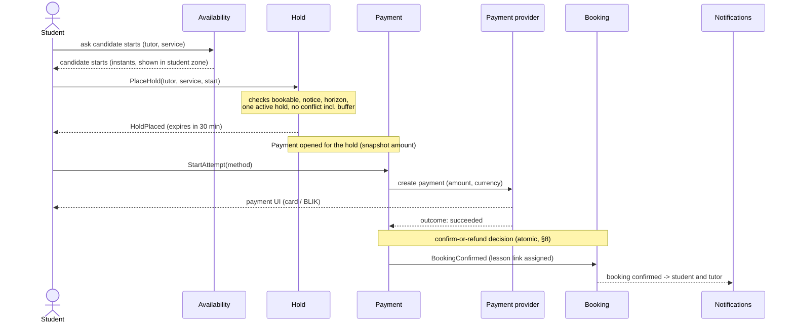
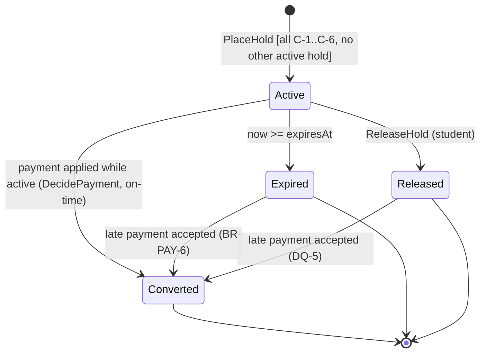
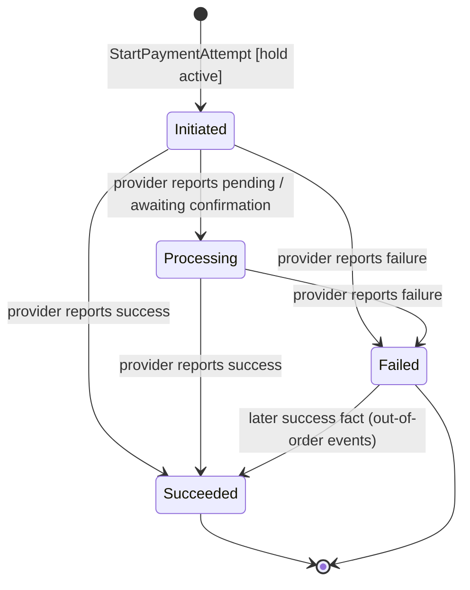
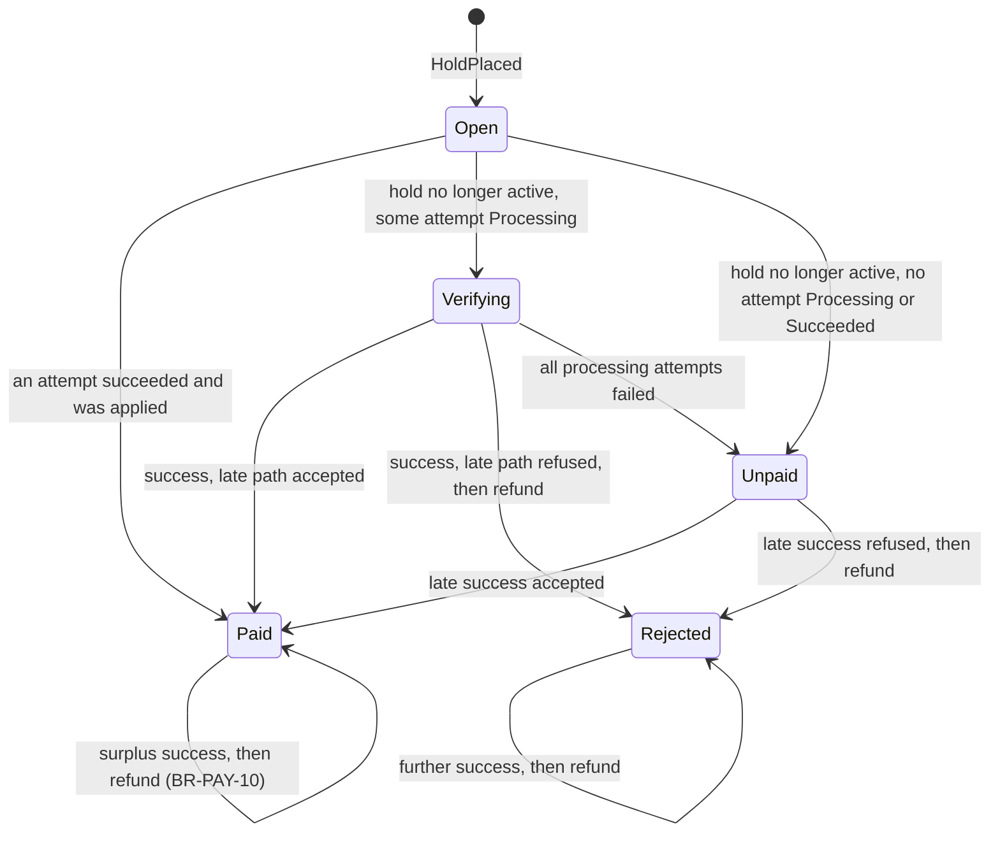
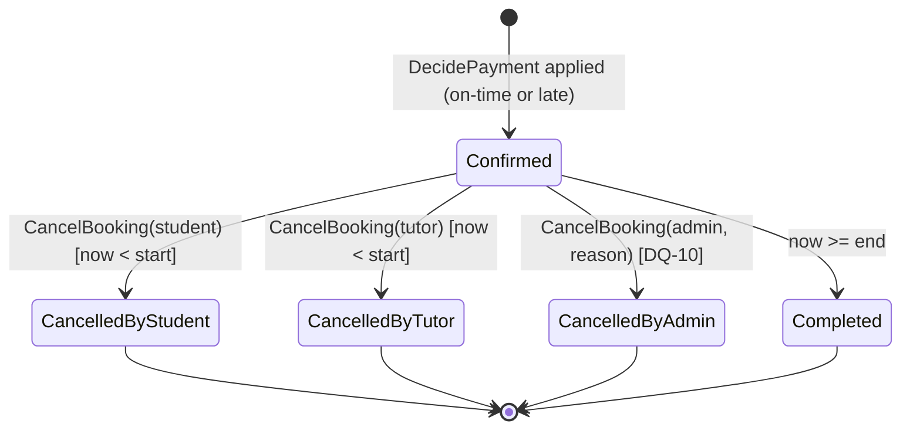
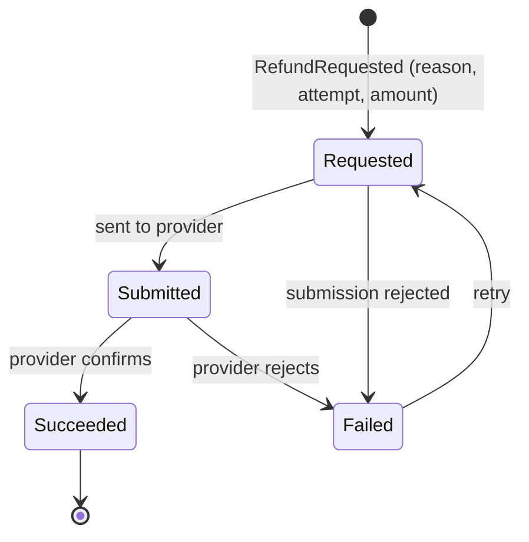
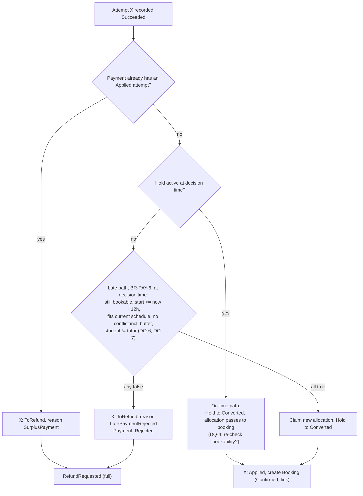
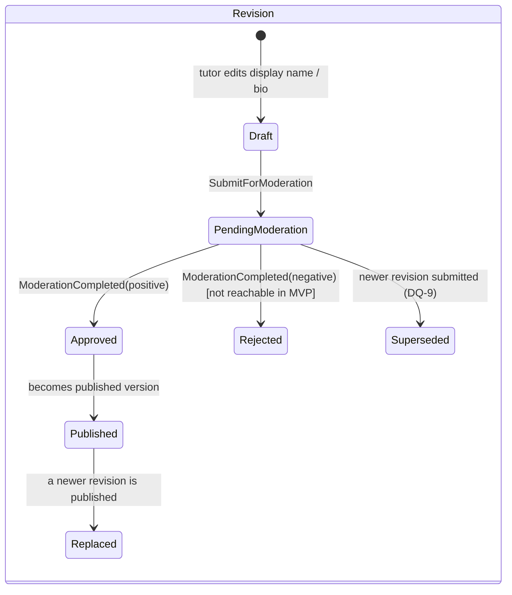
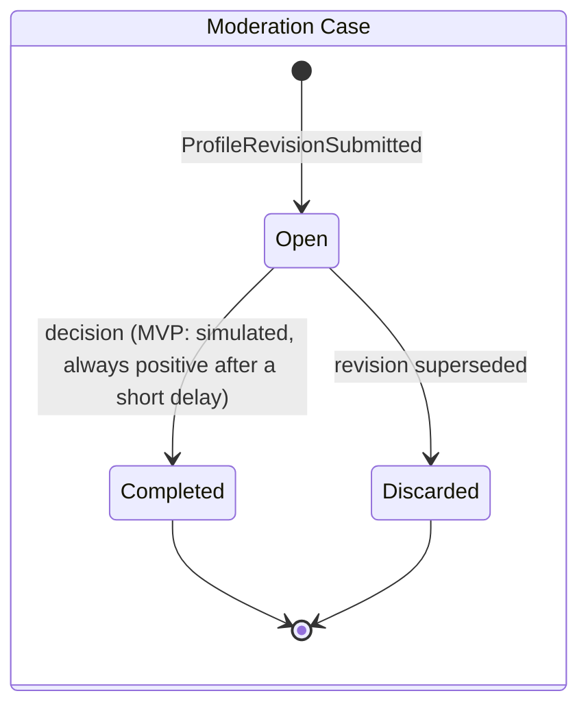

# MentorLink – Domain Model (MVP core)

> **Status:** draft for owner review, 2026-11-12. **Not accepted yet.**
> **Scope:** Hold, Booking, Payment and Payment Attempt, Refund, Availability, Tutor Profile and its moderation cycle. The booking and payment process comes first (§2–§8).
> **Out of scope:** technology, persistence, service boundaries (D-1), concurrency *mechanisms* (D-3), payment provider specifics (D-4). Where this document says "atomic" it states a **consistency requirement**, not an implementation.
> **Sources:** [`product-vision.md`](product-vision.md) (`BR-*`, `EC-*`), [`architecture-discovery.md`](architecture-discovery.md) (design clarifications `G-1`…`G-12`, open topics `D-*`, `X-*`).

**Conventions**

| Marker | Meaning |
|---|---|
| `BR-…` | Business requirement from the product vision. Every rule below cites one. |
| `G-n` | Owner's design clarification (discovery §5.2). |
| `M-n` | **Modelling assumption** made here *within* existing BRs (precise semantics a BR leaves implicit). Listed in §11.1 for review. |
| `DQ-n` | **Open domain question**: the BRs do not determine the answer. A proposed interpretation is given, but nothing is decided until the owner answers (§11.2). |
| `INV-…` | Invariant (must hold after every committed change). |
| *Aggregate* | DDD consistency unit: a cluster changed as a whole, with its own invariants. It says nothing about modules, services or tables. |

No state, transition or rule in this document introduces business behaviour that does not follow from a `BR-*` or `G-n` (G-8). Where readiness for a level-A capability (`EC-5`) is mentioned, it is a check that the model does not block it, not a feature.

---

## 1. Ubiquitous language

| Term | Definition | Source |
|---|---|---|
| **Instant** | A fixed point on the global timeline, independent of any time zone. Bookings and holds start and end at instants. | BR-TZ-4 |
| **Local time / local date** | Wall-clock time or calendar date in a named time zone (IANA id). Tutor schedules are expressed in local time. | BR-TZ-2 |
| **Tutor time zone** | The zone in which the tutor's schedule is defined. | BR-TZ-1 |
| **Weekly schedule** | Recurring local-time windows per weekday when the tutor is available. | BR-AVAIL-2, BR-TZ-2 |
| **Schedule exception** | A date-specific deviation from the weekly schedule (semantics: DQ-2). | BR-AVAIL-2 |
| **Availability window** | A weekly-schedule window (after exceptions) resolved to a concrete instant interval for one local date. | BR-AVAIL-2, BR-TZ-6/7 |
| **Buffer** | One per tutor, default 0. Minimum gap between the end of one lesson and the start of the next; never cumulative. | BR-AVAIL-4 |
| **Service** | Bookable offer: name, description, duration, price, subjects; Active or Withdrawn. | BR-AVAIL-1, BR-PRICE-6 |
| **Terms snapshot** | Copy of service name, duration, price and currency taken at hold creation. Never changes afterwards. | BR-PRICE-4/5 |
| **Allocation** | A claim on the tutor's time, held by an active hold or a confirmed booking. Occupies `[start, end)` and requires the buffer gap to other allocations. | BR-PAY-1, BR-AVAIL-3/4 |
| **Candidate start** | An instant at which a given service could start for a tutor, as computed by availability. | BR-AVAIL-2 |
| **Hold** | Temporary, 30-minute claim on a candidate start by one student, pending payment. | BR-BOOK-1, BR-PAY-1 |
| **Booking** | Confirmed lesson between one student and one tutor at a fixed interval, created by a successful payment. | BR-BOOK-1, EC-5 (1:1) |
| **Payment** | The obligation to pay the snapshot price for one hold, plus everything that happened to it. One per hold. | BR-PAY-5, BR-PAY-10 |
| **Payment attempt** | One try to pay a Payment through the provider with one method (card or BLIK). | BR-PAY-4/5 |
| **Captured amount** | Money confirmed by the provider as successfully paid in an attempt. | BR-PAY-* |
| **Refund** | Return of (all, in the MVP) money captured by one attempt. | BR-CANCEL-6, BR-PAY-6/10 |
| **Decision time** | The instant at which the system processes a payment outcome and decides confirm-or-refund (M-2). | BR-PAY-6/7 |
| **Late payment** | A successful attempt processed when its hold is no longer active. | BR-PAY-6 |
| **Bookable** | Predicate on a tutor: complete, published, not paused, not hidden, not suspended. | BR-ID-5, G-2 |
| **Profile revision** | A submitted version of moderated profile content (display name, bio). | BR-MOD-1/7, G-1 |
| **Published version** | The revision students currently see. | BR-ID-13, BR-MOD-7 |
| **Moderation case** | The (MVP: simulated) review of one revision. | BR-MOD-2/4 |
| **Lesson link** | Unique per-booking address of the lesson page. | BR-MEET-1 |

---

## 2. The booking and payment process

### 2.1 Happy path



### 2.2 Commands, events and policies (overview)

| Step | Command (actor) | Aggregate(s) | Domain event(s) | Policy reacting |
|---|---|---|---|---|
| Browse | — (query) | Availability, Allocations | — | — |
| Hold | `PlaceHold` (student) | Hold, Tutor Allocations, Student Hold Slot, Payment | `HoldPlaced`, `PaymentOpened` | — |
| Pay | `StartPaymentAttempt` (student) | Payment | `PaymentAttemptStarted` | Provider call (outside the transaction) |
| Provider result | `RecordProviderOutcome` (provider) | Payment | `PaymentAttemptSucceeded` / `…Failed` / `…Processing` | **Confirm-or-refund policy** (§8.3) on success |
| Decide | `DecidePayment` (system) | Payment, Hold, Tutor Allocations, Booking, Refund | `BookingConfirmed` + `HoldConverted` **or** `PaymentRejected` + `RefundRequested` | Notifications |
| Release | `ReleaseHold` (student) | Hold, Tutor Allocations, Student Hold Slot | `HoldReleased` | — |
| Expire | time passes (`expiresAt`) | Hold | `HoldExpired` | Payment closure; "payment being verified" status (BR-PAY-8) |
| Cancel | `CancelBooking` (student / tutor / admin) | Booking, Tutor Allocations, Refund | `BookingCancelled`, `RefundRequested` (if eligible) | Notifications, lesson-link revocation |
| Refund | `ExecuteRefund` (system) | Refund | `RefundSucceeded` / `RefundFailed` | Notifications ("refund issued") |
| Complete | time passes (`end`) | Booking | `BookingCompleted` | — |
| Remind | time passes (`start − 24 h`) | — (read Booking) | — | Reminder notification (BR-NOTIF-2) |

---

## 3. Aggregates and responsibilities

| Aggregate | Identity | Owns (responsible for) | Must **not** do | Key invariants |
|---|---|---|---|---|
| **Tutor Schedule** (Availability) | tutor | Time zone, weekly windows, exceptions, buffer; resolving windows to instants per date; validating schedule edits | Know about holds/bookings beyond computing free time; cancel bookings | INV-AV-* |
| **Tutor Allocations** (consistency guard) | tutor | The set of intervals currently claimed by active holds and confirmed bookings of one tutor; enforcing non-overlap with buffer | Own the hold/booking lifecycle | INV-AL-1 |
| **Student Hold Slot** (consistency guard) | student | At most one active hold per student | — | INV-HO-2 |
| **Hold** | hold id | Claim lifecycle (active → converted / released / expired), terms snapshot, expiry instant | Decide payment outcomes; create bookings alone | INV-HO-* |
| **Payment** (with **Payment Attempts** as internal entities) | payment id (1:1 with hold) | Amount due, attempts and their provider facts, which attempt (if any) is **applied** to a booking, refundable balance per attempt | Decide whether time is free; notify | INV-PA-* |
| **Booking** | booking id | Confirmed lesson lifecycle, terms snapshot, cancellation rules and refund eligibility, lesson link | Change its interval or terms; move money itself | INV-BK-* |
| **Refund** | refund id | Execution of one refund against one captured attempt, its provider state | Decide eligibility (decided by Booking or Payment rules) | INV-RF-* |
| **Service** (Offer, supporting) | service id | Name, description, duration, price, subjects, active/withdrawn | — | INV-SV-* |
| **Tutor Profile** | tutor | Revisions, published version, self-pause, administrative restriction, bookability predicate | Moderate content itself; cancel bookings | INV-TP-* |
| **Moderation Case** | case id | Review of one revision; result | Change profile state directly (result is consumed by the profile) | INV-MC-* |

**Why "Tutor Allocations" and "Student Hold Slot" are named separately.** Non-overlap (BR-AVAIL-3/4) and "one active hold per student" (BR-PAY-2) are **set-level invariants**: no single Hold or Booking can check them alone. The model names the guard explicitly. Whether it is realised as a separate aggregate, as Hold/Booking themselves plus a storage-level constraint, or otherwise is decided in **D-3**. Every option must satisfy §9.

---

## 4. Availability

### 4.1 Tutor Schedule – content

- `timeZone`: IANA zone id (BR-TZ-1, BR-TZ-10). Required for completeness (BR-ID-4). Changing it is not an MVP business process (BR-TZ-1). If ever changed, existing holds and bookings keep their instants (BR-TZ-4).
- `weeklyWindows`: per weekday, a list of local-time windows `[localStart, localEnd)`.
- `exceptions`: per local date (DQ-2).
- `buffer`: non-negative duration, default 0 (BR-AVAIL-4). Allowed range and granularity: DQ-13.

### 4.2 Invariants

| ID | Invariant | Source |
|---|---|---|
| INV-AV-1 | Windows of one weekday do not overlap. Adjacent windows (`12:00` end, `12:00` start) are treated as one continuous window. | BR-AVAIL-2 (normalisation) |
| INV-AV-2 | `localStart < localEnd` within one local day. Windows crossing local midnight: DQ-3. | DQ-3 |
| INV-AV-3 | `buffer ≥ 0`. | BR-AVAIL-4 |
| INV-AV-4 | Schedule edits never invalidate, move or cancel existing holds or bookings. | BR-PRICE-7, BR-PRICE-8 |

### 4.3 Resolving windows to instants (DST rules)

For a local date `d` in tutor zone `z`, each window `[ls, le)` becomes the instant interval `[toInstant(d, ls, z, EARLIER), toInstant(d, le, z, LATER))`, where:

| Situation | Rule | Source |
|---|---|---|
| Normal | Unique instant. | BR-TZ-2 |
| `ls` or `le` falls in a **spring-forward gap** | Maps to the instant at which the gap ends (the first existing local time). The non-existent part is dropped; the window is **not shifted**. Example (Warsaw, last Sunday of March): `01:00–04:00` → 2 real hours; `02:30–05:00` → starts at `03:00` CEST. | BR-TZ-6, M-5 |
| `ls` falls in a **fall-back overlap** | Earlier occurrence (summer offset). | BR-TZ-7, M-5 |
| `le` falls in a **fall-back overlap** | Later occurrence (winter offset), so the window lasts the full real elapsed time. Example (Warsaw, last Sunday of October): `01:00–04:00` → 4 real hours. | BR-TZ-7, M-5 |

### 4.4 Candidate starts

Given tutor `t`, active service `s` (duration `D`) and current instant `now`, an instant `x` is a **candidate start** iff all hold:

| # | Condition | Source |
|---|---|---|
| C-1 | `[x, x + D)` lies entirely inside one resolved availability window. `D` is real elapsed time, also across a DST change. | BR-AVAIL-2, BR-TZ-5, M-4 |
| C-2 | `x` lies on the start-time grid (DQ-1). | DQ-1 |
| C-3 | No conflict with any current allocation of `t` (§4.5). | BR-AVAIL-3/4, BR-PAY-1 |
| C-4 | `x ≥ now + 12 h` (minimum notice; `now` = hold creation time when placing a hold). | BR-AVAIL-5 |
| C-5 | `x ≤ now + 8 weeks` (DQ-14 for the exact boundary). | BR-AVAIL-6 |
| C-6 | Tutor `t` is bookable and `s` is Active and belongs to `t`. | BR-ID-5, BR-PRICE-6 |

In a fall-back overlap, two candidates with the same local wall-clock time but different instants are **two separate options** (BR-TZ-7). Candidates are identified by instant; presentation converts each instant into the viewer's zone for that specific date, with the abbreviation and, where ambiguous, the UTC offset (BR-TZ-8, BR-TZ-9).

### 4.5 Conflict rule (buffer)

Two allocations `A = [a1, a2)` and `B = [b1, b2)` of the same tutor **conflict** iff

```
a1 < b2 + buffer  AND  b1 < a2 + buffer
```

which is equivalent to "the gap between them is smaller than the buffer". Each allocation is effectively extended by the buffer at its end only, so buffers do not add up (BR-AVAIL-4). With buffer 15 min, a lesson ending 11:00 allows the next one at 11:15 (gap 15 ≥ 15).

- The **current** buffer is used at the moment of the check (M-3). Allocations that already exist are never re-validated after a buffer change (BR-PRICE-7).
- The buffer applies **between lessons only**, not between a lesson and a window edge (M-4).
- Active holds and confirmed bookings count the same (BR-PAY-1). Released, expired and converted holds, and cancelled bookings, do not count. Completed bookings are in the past and never conflict with a valid candidate (C-4).

### 4.6 Schedule changes and affected bookings

`ChangeSchedule` (tutor) changes windows, exceptions or buffer:

1. Applies to future availability only (BR-PRICE-7).
2. Returns the list of **confirmed future bookings** that would no longer satisfy the new schedule or buffer (BR-PRICE-8). This list is a warning: the change is not rejected, and nothing is cancelled. The same check is available as a preview before the change.
3. Emits `ScheduleChanged`. Visibility is re-evaluated (an emptied weekly schedule removes completeness, G-2).

Active holds are **not** in the BR-PRICE-8 list (the BR names bookings). A hold that later converts keeps its time (BR-PRICE-7). See edge case E-21.

---

## 5. Hold

### 5.1 State machine



| Transition | Trigger | Guard | Effect / event | Source |
|---|---|---|---|---|
| → Active | `PlaceHold(student, tutor, service, start)` | Student account allowed to act (G-3); student ≠ tutor; C-1…C-6; Student Hold Slot empty | Terms snapshot taken; `expiresAt = createdAt + 30 min`; allocation claimed; Payment opened; `HoldPlaced` | BR-BOOK-1, BR-ID-11, BR-PAY-1/2, BR-PRICE-4 |
| Active → Released | `ReleaseHold` by its student | Hold is Active and `now < expiresAt` | Allocation and Student Hold Slot freed immediately; `HoldReleased` | BR-PAY-3 |
| Active → Expired | Time reaches `expiresAt` | — | Allocation and slot no longer count (from `expiresAt` on, see M-1); `HoldExpired` | BR-BOOK-3, BR-PAY-1 |
| Active → Converted | Payment decision, on-time path | Hold still Active at decision time | Allocation transferred to the new booking; `HoldConverted` | BR-BOOK-1 |
| Expired / Released → Converted | Payment decision, late path | BR-PAY-6 conditions met at decision time | New allocation claimed for the booking; `HoldConverted` | BR-PAY-6, DQ-5 |

### 5.2 Invariants

| ID | Invariant | Source |
|---|---|---|
| INV-HO-1 | A hold is **active** iff its state is Active **and** `now < expiresAt`. Expiry is a function of time: no process has to run for an expired hold to stop counting (M-1). | BR-BOOK-3, BR-PAY-1 |
| INV-HO-2 | A student has at most one active hold across the platform. | BR-PAY-2 |
| INV-HO-3 | `expiresAt` is fixed at creation and never extended, including by payment retries. | BR-PAY-1, BR-PAY-5 |
| INV-HO-4 | The terms snapshot never changes. | BR-PRICE-4/5 |
| INV-HO-5 | A hold converts at most once and references at most one booking. | BR-PAY-10 |
| INV-HO-6 | An active hold occupies its interval in Tutor Allocations, with the buffer rule. | BR-PAY-1 |
| INV-HO-7 | A hold never grants access to the lesson page. | BR-MEET-2 |

### 5.3 What does **not** affect an active hold

Service change or withdrawal (BR-PRICE-5), schedule or buffer change (BR-PRICE-7), tutor pause/hide/suspension (BR-ID-9, BR-ID-10: "active holds expire normally"), student suspension (G-3). Whether such changes affect an **on-time payment** of the hold is DQ-4.

---

## 6. Payment and Payment Attempt

### 6.1 Structure

- **Payment** (one per hold): `amountDue` = snapshot price + currency (BR-PRICE-1/2/4), reference to the hold, list of attempts, `appliedAttempt` (0 or 1), derived status.
- **Payment Attempt** (entity inside Payment): method (card, BLIK), provider reference, amount + currency, provider facts received, status, `disposition` once succeeded (Applied / ToRefund).

Attempts live inside Payment so that the outcomes of **all attempts of one hold are decided one at a time** (INV-PA-2). This consistency grouping is a requirement; it does not prescribe storage.

### 6.2 Payment Attempt state machine



| Rule | Detail | Source |
|---|---|---|
| Start | Only while the hold is active. Starting does not change `expiresAt`. Several attempts may exist for one hold (retry after failure, or a second method). | BR-PAY-5 |
| Amount | Attempt amount and currency equal `amountDue`. | BR-PRICE-4 |
| Monotonic facts | Provider outcomes are **facts**, applied monotonically. `Succeeded` is final and overrides an earlier `Failed` received out of order, because money has moved. `Failed` never overrides `Succeeded`. A repeated fact is a no-op. | BR-PAY-9, BR-BOOK-4, M-6 |
| No "abandoned" state | A student abandoning payment leaves the attempt Initiated. The hold expires (BR-BOOK-3). If the provider later reports success, it is a late payment (§8.3). | BR-BOOK-4 |
| Unknown outcome | `Processing` at hold expiry → Payment shows "being verified" (BR-PAY-8). | BR-PAY-8 |

### 6.3 Payment state machine (derived from attempts and decisions)



| State | Meaning for the student | Source |
|---|---|---|
| Open | Hold active, may pay or retry. | BR-PAY-5 |
| Verifying | "Payment being verified". | BR-PAY-8 |
| Paid | Booking confirmed. | BR-BOOK-1 |
| Rejected | Money received but no booking; full refund issued or in progress. | BR-PAY-6 |
| Unpaid | Hold ended without payment; nothing to refund. | BR-BOOK-3 |

`Unpaid` is not final with respect to provider facts: a later success is still processed (E-8). This is why provider truth, not the hold timer, decides money flows.

### 6.4 Invariants

| ID | Invariant | Source |
|---|---|---|
| INV-PA-1 | One Payment per hold; `amountDue` equals the hold's snapshot price and currency. | BR-PRICE-4, BR-PAY-10 |
| INV-PA-2 | At most **one** attempt is Applied. | BR-PAY-10 |
| INV-PA-3 | Every Succeeded attempt ends with disposition Applied **or** ToRefund. None is left without one. | BR-PAY-6, BR-PAY-10 |
| INV-PA-4 | An attempt with disposition ToRefund has exactly one full refund requested (MVP). | BR-PAY-9, BR-CANCEL-6 |
| INV-PA-5 | For each attempt: `sum(refunds requested) ≤ captured amount`. In the MVP every refund is full, so at most one refund per attempt. | BR-PAY-9, BR-CANCEL-6 (partial later, level A) |
| INV-PA-6 | Processing the same provider fact twice has no additional effect. | BR-PAY-9 |
| INV-PA-7 | A Payment is "unresolved" (blocks account deletion) while it is Verifying, or has an attempt that is ToRefund whose refund has not succeeded. | G-11, BR-PRIV-1 |

---

## 7. Booking

### 7.1 State machine



A booking is **created already Confirmed**. There is no "pending" booking: the pre-payment phase is the Hold (BR-BOOK-1). A level-A "tutor approval" (§15 of the vision) could later insert a state between the payment decision and Confirmed without changing Hold or Payment.

| Transition | Guard | Effects | Events | Source |
|---|---|---|---|---|
| → Confirmed | Payment decision applied | Copies terms snapshot, interval, student, tutor; references the applied attempt; **assigns a unique lesson link** | `BookingConfirmed` → notify both | BR-BOOK-1, BR-MEET-1/3, BR-NOTIF-2 |
| → CancelledByStudent | Student is the booking's student; `now < start` | Allocation released. If `start − now ≥ 24 h` (inclusive, G-9) → full refund requested; otherwise none. Link revoked. | `BookingCancelled(by=student, refund=yes/no)` → notify tutor | BR-CANCEL-1/2/4, BR-MEET-3 |
| → CancelledByTutor | Tutor is the booking's tutor; `now < start` | Allocation released; **full refund** requested; link revoked | `BookingCancelled(by=tutor)` → notify student | BR-CANCEL-3 |
| → CancelledByAdmin | Administrator; mandatory reason; audited | Allocation released; **full refund** requested; link revoked | `BookingCancelled(by=admin)` → notify student **and** tutor; student also informed about the refund | BR-ADM-1, BR-ADM-3, BR-ID-8, G-5 |
| → Completed | `now ≥ end` | None. Neutral status, no attendance claim. | `BookingCompleted` | BR-CANCEL-7, BR-MEET-4 |

The 24-hour rule is evaluated at the moment the system processes the cancel command, against the booking's fixed start instant (M-10). Time zones play no role (BR-TZ-4).

### 7.2 Invariants

| ID | Invariant | Source |
|---|---|---|
| INV-BK-1 | Interval, terms snapshot, student and tutor never change after creation. Reschedule = cancel + new booking. | BR-TZ-4, BR-PRICE-5, BR-CANCEL-5 |
| INV-BK-2 | A Confirmed booking occupies its interval in Tutor Allocations; a cancelled one does not. | BR-PAY-1, BR-CANCEL-4 |
| INV-BK-3 | Exactly one booking per applied attempt, and one per hold. | BR-PAY-9/10 |
| INV-BK-4 | Each booking has its own unique lesson link, never shared. | BR-MEET-1 |
| INV-BK-5 | A cancelled booking leads to **at most one** refund. Refunds for a booking are requested exactly when the cancellation rules say so. | BR-CANCEL-*, BR-PAY-9 |
| INV-BK-6 | Student ≠ tutor. | BR-ID-11 |
| INV-BK-7 | A cancellation is never triggered automatically by schedule changes, profile hide/pause/suspension or account suspension. | BR-PRICE-8, BR-ID-8/9/10, G-3 |

### 7.3 Lesson link access (model-level)

Access to the lesson page is evaluated on **every visit** (BR-MEET-6). The domain predicate is: *the visitor is the student or the tutor of this booking, and the booking is Confirmed* (BR-MEET-2, BR-MEET-3). Administrator privilege never grants access (BR-MEET-2, G-10). Open items: access after `Completed` (DQ-11) and for suspended users (G-3 → authorisation model, D-9/D-14).

---

## 8. Refund and the cross-aggregate decisions

### 8.1 Refund state machine



| Element | Detail | Source |
|---|---|---|
| Reasons | `StudentCancellation` (≥ 24 h), `TutorCancellation`, `AdminCancellation`, `LatePaymentRejected`, `SurplusPayment` | BR-CANCEL-1/3, BR-ADM-1, BR-PAY-6, BR-PAY-10 |
| Amount | MVP: full captured amount of the referenced attempt. Model allows less (partial, level A). | BR-CANCEL-6 |
| Failed | Not an end state for the business: the refund stays **unresolved** until it succeeds. How retry and escalation work is a D-4 topic. | G-11 |
| Notification | "Refund issued" when the refund Succeeds (M-11). | BR-NOTIF-2 |

| ID | Invariant | Source |
|---|---|---|
| INV-RF-1 | A refund always references exactly one Succeeded attempt. | BR-PAY-* |
| INV-RF-2 | Per attempt, refunds never exceed the captured amount; in the MVP at most one refund per attempt. | BR-PAY-9, BR-CANCEL-6 |
| INV-RF-3 | Repeating a refund request for the same cause (same booking cancellation, same surplus attempt) yields the same refund, not a second one. | BR-PAY-9 |
| INV-RF-4 | A refund that has not Succeeded is "unresolved" and blocks account deletion of the student. | G-11 |

### 8.2 Hold placement (atomic)

Atomically: check C-1…C-6 against the current state → claim the allocation (INV-AL-1) → occupy the Student Hold Slot (INV-HO-2) → create the Hold with snapshot → open the Payment. Either all of this happens, or none of it.

### 8.3 Confirm-or-refund decision

Triggered by an attempt becoming `Succeeded`. Executed **atomically per Payment**, serialised with every other change of the same tutor's allocations.



Properties required (BR-PAY-7):

- **Unambiguous:** given the committed state at decision time, the outcome is determined. Two concurrent decisions on the same tutor's time cannot both succeed.
- **Recorded once:** the decision (Applied or ToRefund) is part of the same atomic change as the Booking creation or the refund request (INV-PA-3).
- **Independent of event order:** a duplicate success for X finds X already decided (INV-PA-6). A success for a different attempt Y after X was Applied becomes a surplus refund (BR-PAY-10).

### 8.4 Cancellation (atomic)

Atomically: booking transition → allocation released → refund **requested** if eligible. Refund **execution** with the provider happens afterwards and may be retried (§9.2).

---

## 9. Transactional consistency boundaries

### 9.1 Must be atomic (strong consistency)

| # | Unit of atomicity | Invariants protected | Why it cannot be eventual |
|---|---|---|---|
| TX-1 | **Hold placement:** Tutor Allocations(t) + Student Hold Slot(s) + Hold + Payment opened | INV-AL-1, INV-HO-2, INV-HO-6, INV-PA-1 | Otherwise two students get the same time (BR-BOOK-4), or one student gets two holds (BR-PAY-2). |
| TX-2 | **Payment decision:** Payment (attempt disposition) + Hold + Tutor Allocations(t) + Booking created + refund requested | INV-PA-2/3, INV-HO-5, INV-AL-1, INV-BK-3 | BR-PAY-7 demands an unambiguous decision under concurrent booking. BR-PAY-10 demands at most one applied attempt. |
| TX-3 | **Hold release:** Hold + Tutor Allocations(t) + Student Hold Slot(s) | INV-AL-1, INV-HO-2 | "Time returns to availability immediately" (BR-PAY-3). |
| TX-4 | **Booking cancellation:** Booking + Tutor Allocations(t) + refund requested (if eligible) | INV-BK-2, INV-BK-5 | A cancelled refundable booking without a refund, or a refund twice, breaks BR-CANCEL-1/3 and BR-PAY-9. *Alternative:* refund request as a guaranteed, idempotent follow-up of the cancellation (keyed by booking). Both satisfy the model; the choice is input to D-1/X-2. |
| TX-5 | **Recording a provider fact:** fact deduplicated + attempt state updated | INV-PA-6 | Duplicate notifications (BR-PAY-9). TX-5 and TX-2 may be one unit. |
| TX-6 | **Refund request:** refund created + attempt's refundable balance updated | INV-RF-2, INV-PA-5 | Prevents a double refund. |
| TX-7 | **Moderation result applied:** revision state + published version (if approved) | INV-TP-2, INV-TP-3 | The published version must never point to an unapproved or superseded revision. |
| TX-8 | **Administrative operation + its audit entry** | BR-ADM-3 | "Every administrative operation is audited." An operation must not commit without its audit record (or a guaranteed, equivalent follow-up). |

**Consequence for D-1 (stated as a requirement, not a decision):** TX-1 and TX-2 both span **Tutor Allocations, Hold, Payment and Booking**. Whatever module or service grouping is chosen, these four must share one consistency mechanism able to serialise per tutor. Splitting them across independently committing units would replace a local atomic decision with distributed coordination, against BR-PAY-7 and EC-3 priority 1.

### 9.2 May be eventually consistent

| Process | Allowed lag | Requirement that remains | Source |
|---|---|---|---|
| Refund **execution** at the provider | Seconds to days | Requested refunds are never lost; retried until Succeeded; idempotent | BR-PAY-6, G-11 |
| Notifications (in-app, e-mail) | Seconds to minutes | Never block or roll back; not silently lost for business events | BR-NOTIF-4 |
| `Hold → Expired` state recording | Any (correctness comes from INV-HO-1) | Must eventually be recorded, to close the Payment and show "being verified" | BR-BOOK-3, BR-PAY-8 |
| `Booking → Completed` recording | Minutes | Must eventually be recorded (anchor for future reviews, BR-REV-2) | BR-CANCEL-7 |
| 24 h reminder | Minutes | Sent once per booking; not for cancelled bookings | BR-NOTIF-2 |
| Moderation processing (simulated delay) | Seconds | The result is applied once (idempotent per revision) | BR-MOD-2 |
| Discovery listing | Seconds | Shows visible tutors and published versions only; **hold placement never relies on it** (C-6 checks the authoritative profile state) | BR-DISC-3 |

### 9.3 Read-consistency requirements without locking

Changes to the **tutor profile** (pause, hide, suspension, completeness) and to the **schedule** do not need to be in the same atomic unit as TX-1/TX-2. Hold placement and payment decisions must read their **latest committed** state, and either serial order of a concurrent change and a placement is acceptable, because those changes never invalidate existing holds or bookings (BR-PRICE-7, BR-ID-8/9/10). A stale copy, such as a cache or the search index, is **not** acceptable as input to TX-1/TX-2.

---

## 10. Tutor Profile and moderation

### 10.1 Structure (three independent dimensions, BR-ID-13)

| Dimension | Content | Changed by |
|---|---|---|
| **Published version** | The approved revision (display name, bio) students see; none before the first approval | Moderation result (BR-MOD-7) |
| **Pending revision** | At most one submitted revision and its moderation status (Pending / Approved / Rejected) | Tutor submit; moderation result |
| **Visibility** | *Derived:* bookable or not (§10.3) | Pause, admin restriction, completeness, publication |

Also owned: `pausedByTutor` (BR-ID-9) and `adminRestriction ∈ {None, Hidden, Suspended}` (BR-ID-7, BR-ID-10; difference: DQ-8).
Not owned: services (Offer), schedule and time zone (Availability), Tutor role (Identity, BR-ID-3).

### 10.2 Revision and moderation state machines





| Rule | Detail | Source |
|---|---|---|
| Separation | The profile emits `ProfileRevisionSubmitted` and consumes `ModerationCompleted(revisionId, result)`. It does not know how the decision is made. A real moderation (e.g., LLM-assisted) replaces only the Moderation Case's decision step. | BR-MOD-4, D-7 |
| Simulation | MVP decision: positive, after a few seconds. | BR-MOD-2 |
| Publication | On a positive result the revision becomes the published version, replacing the previous one. The tutor is notified that moderation finished. | BR-MOD-3, BR-MOD-7, BR-NOTIF-2 |
| Visibility during re-moderation | The previous published version stays visible. A pending revision never hides a visible profile. | BR-MOD-7 |
| Meaning | Approval ≠ competence verification ≠ reviews. | BR-MOD-5/6 |
| Rejected | A modelled state, **unreachable in the MVP**, kept so real moderation needs no redesign (level A). No rejection behaviour (appeals, messages) is defined. | BR-MOD-4, §15 |
| Idempotency | A result for a superseded or already-decided revision is ignored. | BR-MOD-4 |

BR-MOD-3 says the profile is "published if it meets completeness rules". Under G-2, completeness is evaluated continuously on operational data. The model therefore **always** publishes an approved revision as the published version and makes completeness a condition of **visibility** (M-7). The observable behaviour is the same: students see the profile only when it is complete and approved.

### 10.3 Bookable predicate

```
bookable(t) = publishedVersion exists
            ∧ complete(t)              -- G-2, evaluated on current data
            ∧ ¬pausedByTutor
            ∧ adminRestriction = None
            ∧ [tutor account not suspended]   -- DQ-7

complete(t) = published bio not empty            -- BR-ID-4
            ∧ ≥ 1 Active service                 -- BR-ID-4, BR-PRICE-6
            ∧ weekly schedule has ≥ 1 window     -- BR-ID-4
            ∧ time zone set                      -- BR-ID-4, BR-TZ-1
```

"Visible in search" and "bookable" are the same predicate (BR-ID-5).

### 10.4 Profile state transitions

| Command | Actor | Guard | Effect | Events / notifications | Source |
|---|---|---|---|---|---|
| `SubmitForModeration` | Tutor (holds Tutor role) | Draft passes field validation | Revision → PendingModeration; case opened | `ProfileRevisionSubmitted` | BR-MOD-1, BR-ID-2/3 |
| `Pause` / `Resume` | Tutor | — | `pausedByTutor` toggled | `TutorVisibilityChanged` | BR-ID-9 |
| `HideProfile` / `Unhide` | Admin (reason) | — | `adminRestriction` Hidden / None | Audit; notify tutor on hide | BR-ID-7, BR-ADM-3, BR-NOTIF-2 |
| `SuspendProfile` / `LiftSuspension` | Admin (reason) | Only an admin lifts | `adminRestriction` Suspended / None | Audit; notify tutor on suspension | BR-ID-10, BR-ADM-3, BR-NOTIF-2 |
| Completeness change | (via Offer / Availability changes) | — | Re-evaluated | `TutorVisibilityChanged` | G-2 |

None of these cancels or changes holds or bookings (INV-BK-7).

### 10.5 Invariants

| ID | Invariant | Source |
|---|---|---|
| INV-TP-1 | Role (Identity) and profile status are separate. Holding the Tutor role publishes nothing. | BR-ID-3 |
| INV-TP-2 | The published version is always an Approved revision. | BR-MOD-7 |
| INV-TP-3 | At most one pending revision per profile. | BR-ID-13 (DQ-9) |
| INV-TP-4 | A pending revision never changes visibility. | BR-MOD-7 |
| INV-TP-5 | Only an administrator lifts an administrative suspension. | BR-ID-10 |
| INV-TP-6 | Students see only the tutor's display name from the published version, never an e-mail. | BR-PRIV-4, G-6 |
| INV-MC-1 | Exactly one result per moderation case; it applies only to its own revision. | BR-MOD-4 |

### 10.6 Service (supporting, needed by the core)

| ID | Invariant | Source |
|---|---|---|
| INV-SV-1 | Duration 15–240 min in 15-min steps; price 1–2000 PLN, gross; currency stored with the amount. | BR-AVAIL-7, BR-PRICE-1/2 |
| INV-SV-2 | Withdrawn services cannot be held; their history is kept while bookings reference them. | BR-PRICE-6 |
| INV-SV-3 | Changing or withdrawing a service never alters existing holds or bookings (snapshot). | BR-PRICE-5 |
| INV-SV-4 | Services are assigned to catalogue subjects (DQ-12: at least one?). | BR-DISC-2 |
| INV-AL-1 | *(Tutor Allocations)* No two active allocations of one tutor conflict under §4.5. | BR-AVAIL-3/4, BR-PAY-1 |

---

## 11. Assumptions and open questions

### 11.1 Modelling assumptions (within existing BRs) – please confirm

| ID | Assumption | Based on |
|---|---|---|
| M-1 | Hold expiry is defined by time (`now ≥ expiresAt`), not by a process running. The Expired state is recorded afterwards. | BR-BOOK-3, BR-PAY-1 |
| M-2 | "Payment confirmed after its hold expired" is judged at **decision time** (when the system processes the success), not by the provider's timestamp. A success sent by the provider before expiry but processed after it follows the late path, which still confirms if the time is free. | BR-PAY-6/7/8 |
| M-3 | The conflict check uses the buffer valid at the moment of the check. | BR-AVAIL-4, BR-PRICE-7 |
| M-4 | A lesson must fit entirely inside one availability window. The buffer applies between lessons, not at window edges. | BR-AVAIL-2/4 |
| M-5 | DST mapping: window start → earlier occurrence, window end → later occurrence; gap boundaries → end of the gap. | BR-TZ-6/7 |
| M-6 | Provider outcomes are monotonic facts; Succeeded overrides Failed; duplicates are no-ops. | BR-PAY-9, BR-BOOK-4 |
| M-7 | An approved revision is always published; completeness gates visibility, not publication. | BR-MOD-3, G-2 |
| M-8 | Hold placement and decisions read the latest committed profile and schedule state; either order of a concurrent change is acceptable. | BR-PRICE-7, BR-ID-8/9/10 |
| M-9 | Account deletion first blocks new actions of the account, then checks preconditions, so no hold or booking can appear between check and deletion. | BR-PRIV-1, G-3 |
| M-10 | The 24 h cancellation threshold is evaluated at processing time of the cancel command against the start instant. | BR-CANCEL-1/2, G-9 |
| M-11 | The "refund issued" notification is sent when the refund succeeds, not when it is requested. | BR-NOTIF-2 |

### 11.2 Open domain questions

**Blocking the booking core (answer before D-2/D-3):**

| ID | Question | Options | Proposed interpretation |
|---|---|---|---|
| DQ-1 | **Start-time grid.** BR-AVAIL-2 says the system computes start times but not at what step. | (a) every 15 min aligned to local quarter-hours; (b) every 15 min from each window's start; (c) step = service duration from window start; (d) every 5 min | (a): matches the 15-min duration step (BR-AVAIL-7) and keeps start times readable. In a spring-forward gap, aligned instants that do not exist are skipped. |
| DQ-4 | **On-time payment after the tutor stopped being bookable during the hold** (pause, admin hide/suspension, lost completeness). BR-ID-10 says holds "expire normally"; BR-ID-9 says a hidden profile "accepts no new bookings". | (a) An active hold is a commitment: on-time payment confirms; the admin may cancel later with a full refund (BR-ID-8). (b) Bookability is re-checked at every confirmation: on-time payment for a non-bookable tutor → full refund. | (a). It matches BR-PRICE-5/7 (holds stay valid), "expire normally" and BR-PAY-6 restricting the bookability re-check to the late path. Needs explicit confirmation because (b) is also a plausible reading of BR-ID-9. |
| DQ-5 | **Success after the student released the hold** (e.g., BLIK confirmed seconds after pressing cancel). | (a) Same as late payment (BR-PAY-6): confirm if still free, otherwise refund. (b) Always refund. | (a): BR-PAY-6 is the only rule for a success on a no-longer-active hold; (b) would add a new rule. |
| DQ-6 | **Late payment for a service withdrawn after hold expiry.** "All business rules" in BR-PAY-6 might include "service is offered". | (a) Withdrawal does not block (terms snapshot, BR-PRICE-5). (b) Withdrawn service → refund. | (a). |
| DQ-2 | **Schedule exception semantics.** | (a) Exception replaces a date's windows (empty = day off; may also add time); (b) exception only removes time | (a): covers both day-off and changed hours with one concept. |
| DQ-3 | **Windows crossing local midnight** (e.g., 22:00–01:00). | (a) Not allowed; tutor defines two windows; (b) allowed | (a): simpler with no loss of expressiveness; adjacent windows merge (INV-AV-1). |
| DQ-14 | **Horizon boundary.** | Start ≤ hold creation + 56 days (inclusive), measured on instants | As stated. |

**Not blocking the core:**

| ID | Question | Proposed interpretation |
|---|---|---|
| DQ-7 | Does suspending a tutor's **account** (not profile) make the profile non-bookable? | Yes: a tutor whose account is suspended cannot be newly booked; existing bookings remain (G-3). |
| DQ-8 | What distinguishes an admin **hide** from an admin **suspension** of a profile in the MVP? | Same effect on visibility, both lifted only by an admin; they differ only in label and notification wording. |
| DQ-9 | Submitting a new revision while one is pending. | The new revision supersedes the pending one; the old result is ignored. |
| DQ-10 | Time window for admin cancellation. | Before the lesson starts, like student and tutor cancellations; later cases are disputes (BR-CANCEL-7). |
| DQ-11 | Lesson page access after `Completed`. | Still allowed for the participants; only cancellation revokes (BR-MEET-3). Suspended users: deferred to the authorisation model (G-3). |
| DQ-12 | Must every Active service have at least one subject? | Yes, at least one, so that it is discoverable by subject (BR-DISC-1/2). |
| DQ-13 | Range and granularity of the buffer. | Needs an owner value; the model only requires `≥ 0`. |

### 11.3 Observations (no change proposed)

- **No student-side conflict rule exists.** A student may hold bookings with two different tutors at overlapping times; no BR forbids it, so the model does not enforce it.
- **Late payment vs the student's own new hold.** If a student's hold expired, they placed a new hold on the same time, and the old payment then succeeds, the late path finds a conflict (with their own hold) and refunds (E-10). This follows from the BRs as written.

---

## 12. Concurrency cases and edge cases

| # | Scenario | Expected outcome | Requirement on the model | Source |
|---|---|---|---|---|
| E-1 | Two students place holds on overlapping times of one tutor simultaneously | Exactly one hold; the other gets "no longer available" | TX-1 serialised per tutor | BR-BOOK-4, BR-AVAIL-3 |
| E-2 | One student places two holds at once (two tabs, double click) | Exactly one hold | TX-1 includes Student Hold Slot | BR-PAY-2 |
| E-3 | Late success of S1's expired hold vs S2 placing a hold on that time, concurrently | Exactly one wins: either S2's hold (S1 refunded) or S1's booking (S2's placement rejected) | TX-1 and TX-2 serialised per tutor | BR-PAY-7 |
| E-4 | Two attempts of one hold succeed (e.g., card and BLIK) | One Applied, one full refund | INV-PA-2/3, TX-2 per Payment | BR-PAY-10 |
| E-5 | Provider sends the same success twice, possibly concurrently | One booking, no refund | TX-5, INV-PA-6 | BR-PAY-9 |
| E-6 | Failure arrives after success (out of order) | Stays Succeeded | M-6 | BR-BOOK-4 |
| E-7 | Success arrives after failure for the same attempt | Becomes Succeeded, then decided normally | M-6 | BR-BOOK-4 |
| E-8 | Student abandons payment; hold expires; provider later reports success | Late path: confirm if free, otherwise refund | §8.3 | BR-BOOK-4, BR-PAY-6 |
| E-9 | Outcome still Processing at expiry | Hold expires; Payment Verifying; student sees "being verified"; later result via late path; student notified of result | §6.3 | BR-PAY-8 |
| E-10 | Late success while the same student holds the same time again | Conflict → refund of the late payment; new hold unaffected | §11.3 | BR-PAY-6 |
| E-11 | Success processed exactly at `expiresAt` | Hold not active (INV-HO-1) → late path | M-1, M-2 | BR-PAY-6 |
| E-12 | Late success when start is now < 12 h away | Refund | §8.3 | BR-PAY-6 |
| E-13 | Late success after tutor paused / was hidden / suspended | Refund | §8.3 | BR-PAY-6, BR-ID-10 |
| E-14 | On-time success after tutor became non-bookable during the hold | Depends on DQ-4 | DQ-4 | BR-ID-9/10 |
| E-15 | Student releases hold while an attempt is Processing; it then succeeds | Late path (DQ-5) | DQ-5 | BR-PAY-3/6 |
| E-16 | Student retries after failure | New attempt; `expiresAt` unchanged | INV-HO-3 | BR-PAY-5 |
| E-17 | Student and tutor cancel the same booking concurrently | Exactly one cancellation (first committed); exactly one refund decision per its rules | TX-4 | BR-CANCEL-*, BR-PAY-9 |
| E-18 | Student cancels exactly 24 h before start | Full refund | G-9, M-10 | BR-CANCEL-1 |
| E-19 | Cancel request at or after start | Rejected; booking stays Confirmed → Completed | §7.1 | BR-CANCEL-2/3 |
| E-20 | Cancel command repeated (retry) | Second has no effect; no second refund | INV-BK-5, INV-RF-3 | BR-PAY-9 |
| E-21 | Tutor changes schedule while a hold is active, or a hold is placed concurrently with the change | Hold valid; if paid on time, the booking stands even outside the new schedule; it was not in the BR-PRICE-8 warning list because it was a hold | §4.6, M-8 | BR-PRICE-7/8 |
| E-22 | Tutor raises the buffer; existing bookings now too close | Bookings stay; listed in the warning; new holds use the new buffer | M-3 | BR-PRICE-7/8 |
| E-23 | Tutor withdraws a service during an active hold | Hold and its on-time payment unaffected | INV-SV-3 | BR-PRICE-5 |
| E-24 | Tutor withdraws the last service while visible | Profile stops being bookable; holds and bookings unaffected | G-2, INV-BK-7 | BR-ID-4/5 |
| E-25 | Admin suspends tutor with future bookings | Bookings remain; admin may cancel each explicitly with full refund + notify both | INV-BK-7 | BR-ID-8, G-5 |
| E-26 | Refund rejected by the provider | Refund Failed → retried; unresolved until Succeeded | §8.1 | G-11 |
| E-27 | Account deletion requested while a payment is Verifying or a refund is pending | Rejected | INV-PA-7, INV-RF-4 | G-11, BR-PRIV-1 |
| E-28 | Deletion requested concurrently with the student placing a hold | Either the hold wins (deletion rejected) or deletion proceeds (hold rejected) | M-9 | BR-PRIV-1 |
| E-29 | Provider success arrives for an attempt of a deleted student's old hold (session left open) | Late path → refund; notification not deliverable (identifying data deleted) | §8.3; D-4 should close provider sessions on hold end | BR-PRIV-1/2/3 |
| E-30 | Success with amount or currency different from `amountDue` | Not applicable to a booking: ToRefund, flagged for investigation | INV-PA-1 (integrity guard, no new business rule) | BR-PRICE-4 |
| E-31 | Two moderation results for the same revision | First applies; second ignored | INV-MC-1 | BR-MOD-4 |
| E-32 | Moderation result for a superseded revision | Ignored | DQ-9 | BR-MOD-7 |
| E-33 | Tutor tries to book own service (holding both roles) | Rejected | INV-BK-6 | BR-ID-11 |
| E-34 | Hold placed for a start inside a fall-back repeated hour | Hold references one specific instant; the second occurrence is a different candidate | §4.3/4.4 | BR-TZ-7 |
| E-35 | Lesson spans a DST change | Duration = real elapsed time; local end time shifts by one hour | §4.4 C-1 | BR-TZ-5 |
| E-36 | Student and tutor in zones with different DST dates | Times converted per date; no fixed offset | §4.4 | BR-TZ-8 |

---

## 13. Domain events (catalogue)

| Event | Emitted by | Consumers (policies) | Notification (BR-NOTIF-2) |
|---|---|---|---|
| `HoldPlaced` | Hold | Payment opened | — |
| `HoldReleased` / `HoldExpired` | Hold | Payment status (Unpaid / Verifying) | — |
| `HoldConverted` | Hold | — | — |
| `PaymentAttemptStarted` | Payment | Provider call | — |
| `PaymentAttemptSucceeded` | Payment | Confirm-or-refund (§8.3) | — |
| `PaymentAttemptFailed` | Payment | — | Payment failed (student) |
| `PaymentRejected` | Payment | Refund requested | Payment result after verification (if it was Verifying) |
| `BookingConfirmed` | Booking | Lesson link, reminder scheduling | Booking confirmed (both); payment result after verification (if it was Verifying) |
| `BookingCancelled` | Booking | Refund requested (if eligible), link revoked | Cancellation (other party; admin case: both, G-5) |
| `BookingCompleted` | Booking | (future reviews) | — |
| `RefundRequested` | Refund | Provider call | — |
| `RefundSucceeded` | Refund | Payment/attempt resolved | Refund issued (student) |
| `RefundFailed` | Refund | Retry / escalation (D-4) | — |
| `ScheduleChanged` | Tutor Schedule | Visibility re-evaluation | — |
| `ProfileRevisionSubmitted` | Tutor Profile | Moderation case opened | — |
| `ModerationCompleted` | Moderation Case | Profile applies the result | Moderation finished (tutor) |
| `TutorVisibilityChanged` | Tutor Profile | Discovery listing | Hidden / suspended by admin (tutor) |

The 24 h reminder is time-triggered from a Confirmed booking (X-1), not an event.

---

## 14. Readiness checks (EC-5, level A)

| Future capability | Does the model block it? |
|---|---|
| Real payouts and settlements (BR-SCOPE-3) | No. Applied attempts are linked to bookings; a future settlement can reference Completed bookings and their applied payment. |
| Partial refunds (BR-CANCEL-6) | No. Refund amount ≤ refundable balance per attempt (INV-PA-5). |
| Multiple currencies (BR-PRICE-2) | No. Every amount is Money (amount + currency). |
| Real moderation (BR-MOD-4) | No. Only the Moderation Case decision changes; Rejected already modelled. |
| Real video behind the lesson page (BR-MEET-7) | No. The link identifies the booking and the page; the room is resolved on visit. |
| Atomic reschedule keeping the payment (BR-CANCEL-5) | No. Booking references the applied attempt; a reschedule can move the allocation within TX-2-like atomicity. |
| Optional tutor approval (§15) | No. A state can be inserted between payment decision and Confirmed. |
| Reviews (BR-REV-2) | No. `Completed` is the anchor; one review per booking. |
| Group lessons (level C) | Consciously not supported: the booking is 1:1 (EC-5). |

---

## 15. Traceability (BR → model)

| BR group | Covered in |
|---|---|
| BR-BOOK-1..4 | §2, §5, §8.3, §12 |
| BR-AVAIL-1..7 | §4, §10.6 |
| BR-TZ-1..10 | §4.1, §4.3, §4.4, E-34..36 |
| BR-PAY-1..10 | §5, §6, §8.3, §9, §12 |
| BR-PRICE-1..8 | §4.6, §5.2, §6.4, §10.6 |
| BR-CANCEL-1..7 | §7, §8.4 |
| BR-ID-1..13, BR-MOD-1..7 | §10 |
| BR-MEET-1..7 | §7.3 |
| BR-NOTIF-1..4 | §9.2, §13 |
| BR-PRIV-1..3 | INV-PA-7, INV-RF-4, M-9, E-27..29 |
| BR-ADM-1/3 | §7.1, TX-8 |

---

## 16. Next steps (after owner acceptance)

1. Owner answers DQ-1…DQ-14 and confirms or corrects M-1…M-11.
2. Turn §4.3–§4.5 and E-34..36 into worked time examples → **D-2**.
3. Choose the mechanism for TX-1…TX-6 and hold expiry (§9) → **D-3**, X-1.
4. Use §9.1 as the main input for **D-1**.

Change log: 2026-11-12 v1 draft.
