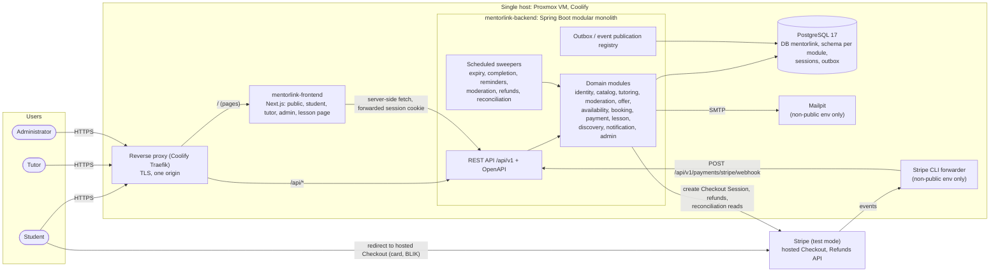
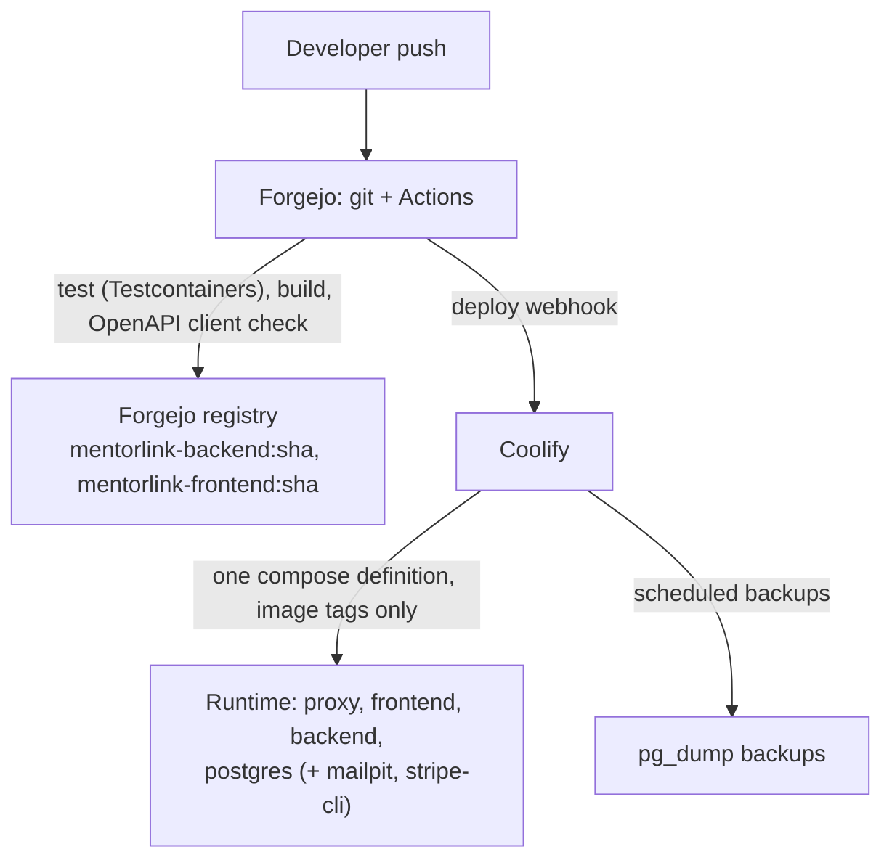
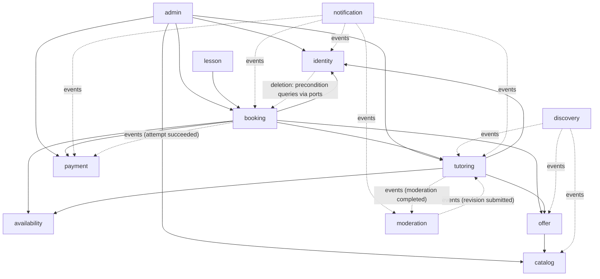
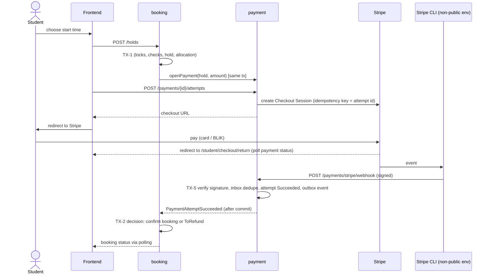
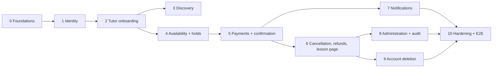

# MentorLink – Target Architecture and Implementation Plan

> **Status:** proposal for owner acceptance, 2026-11-12.
> **Inputs:** [`product-vision.md`](product-vision.md), [`architecture-discovery.md`](architecture-discovery.md), [`domain-model.md`](domain-model.md), [`review/2026-11-11-mentorlink-codebase-architecture.html`](review/2026-11-11-mentorlink-codebase-architecture.html), [`../code-map.md`](../code-map.md).
> **This document takes decisions.** Each decision lists the alternatives considered and the reason for the choice, and will be recorded as an ADR in `docs/architecture/adr/` when the stage that needs it starts (§12). Open domain questions (`DQ-*`) do **not** block this design: where one matters, the proposed interpretation from the domain model is used as the **default** and can be changed later at low cost (§11.3).

---

## 1. Summary of decisions

| # | Decision | Chosen | Main alternatives rejected | Driver |
|---|---|---|---|---|
| AD-1 | System shape (D-1) | **Modular monolith**: one Spring Boot backend with enforced domain modules, plus the Next.js frontend | Microservices per domain; keeping separate services | Booking/payment atomicity (TX-1/TX-2), EC-1, EC-4 |
| AD-2 | auth-service | **Merged into the backend as the `identity` module.** The separate deployable is retired. | Keep it separate with JWKS; self-hosted IdP (Keycloak) | §3 |
| AD-3 | Authentication and sessions (D-14) | **Server-side sessions stored in PostgreSQL**, `HttpOnly` cookie, CSRF protection, single origin | JWT access + refresh cookies; Bearer tokens in JS; BFF token holder | Immediate revocation (suspension), no key management, one backend |
| AD-4 | Entry point | **One origin** behind Coolify's reverse proxy: `/` → frontend, `/api` → backend. Only the proxy is exposed. | Next.js rewrite as the gateway; separate origins + CORS | CM-R1, CM-R11–13, BR-ENV-2 |
| AD-5 | Data (D-1, D-11) | **One PostgreSQL database, one schema per module**, no cross-schema foreign keys or queries | Database per module; shared schema | Ownership without operational overhead |
| AD-6 | Concurrency (D-3) | **Per-tutor and per-student row locks** around every allocation change, application-level conflict rule, plus a DB exclusion constraint on confirmed bookings as a backstop | Pure exclusion constraints; optimistic retries; serialisable isolation | Buffer and time-based expiry cannot be expressed as a static constraint |
| AD-7 | Asynchronous processing (X-1, X-2) | **Transactional outbox in PostgreSQL** (Spring Modulith event publication registry) plus `@Scheduled` sweepers. **No message broker.** | RabbitMQ/Kafka; in-memory events only | BR-NOTIF-4, reliable payment follow-up, EC-4 |
| AD-8 | Payments (D-4) | **Stripe in test mode, hosted Checkout**, webhooks + reconciliation polling, idempotent inbox | Embedded Payment Element; other providers | BR-PAY-4, BR-ADM-2 (no card data), solo effort |
| AD-9 | Webhook ingress (D-5) | **Stripe CLI forwarder container** in the non-public environment, plus a reconciliation job. The same endpoint receives real webhooks after a public deployment. | Public tunnel; polling only | BR-ENV-1, zero budget |
| AD-10 | Time (D-2) | Schedules as `LocalTime` + IANA `ZoneId`; holds and bookings as UTC instants (`timestamptz`); slot expansion in domain code; injectable `Clock` | Pre-materialised slots; storing local times for bookings | BR-TZ-* |
| AD-11 | Search (D-10) | PostgreSQL full-text search + filters on a discovery read model owned by the `discovery` module | Elasticsearch/OpenSearch/Meilisearch | MVP volume, EC-4 |
| AD-12 | Notifications (D-6) | In-app notifications table + SMTP e-mail; **Mailpit** as the test mailbox | SaaS e-mail sandbox | BR-NOTIF-3, zero budget |
| AD-13 | API contract (X-4) | **Code-first OpenAPI** from springdoc → generated TypeScript client in the frontend, checked in CI | Hand-written types (today); spec-first | CM-R2 |
| AD-14 | Tests (X-6) | **Testcontainers PostgreSQL** with real Flyway migrations; module tests; concurrency tests; Playwright E2E for the journey | H2 (today) | Booking correctness depends on PostgreSQL semantics |
| AD-15 | Infrastructure gate (D-15) | Runtime: proxy (already in Coolify), frontend, backend, PostgreSQL. **Non-public env only:** Mailpit, Stripe CLI. Nothing else in the MVP. | Broker, IdP, search engine, Redis, tracing stack | EC-4 |

---

## 2. Target system structure

### 2.1 Deployables

| Deployable | Status vs today | Responsibility |
|---|---|---|
| **mentorlink-frontend** (Next.js) | **Extended** | Public discovery, auth pages, Student/Tutor/Admin areas, lesson page, payment return pages |
| **mentorlink-backend** (Spring Boot, modular monolith) | **Extended**: absorbs auth-service, gains all MVP modules | Entire business logic, REST API, Stripe integration, scheduled jobs, outbox |
| **auth-service** | **Retired** (code moved into `identity`, §3.3) | — |
| **PostgreSQL 17** | Kept: one database `mentorlink`, schema per module (replaces `auth_db` / `tutor_db`) | All persistent state incl. sessions and outbox |
| **Reverse proxy** | Already present in Coolify (Traefik); now the only exposed entry | TLS, routing `/` and `/api` on one origin |
| **Mailpit** | New, **non-public environments only** | Captures every outgoing e-mail (BR-NOTIF-3) |
| **Stripe CLI forwarder** | New, **non-public environments only** | Forwards Stripe test events to the backend without exposing the app (BR-ENV-1) |

Runtime footprint: **3 application containers** (frontend, backend, PostgreSQL) plus **2 lightweight dev/test helpers**, compared with 4 application containers today. Rough memory: backend 512–768 MB, frontend ~150 MB, PostgreSQL ~200–300 MB, Mailpit and Stripe CLI ~30 MB each.

### 2.2 Target architecture diagram



After a later public deployment (BR-ENV-2), Stripe calls `/api/v1/payments/stripe/webhook` through the proxy directly; Stripe CLI and Mailpit are removed and SMTP points to a real relay. No code changes.

### 2.3 Deployment view



---

## 3. Should auth-service remain a separate service? – No

### 3.1 Evaluation

| Criterion | Keep separate (evolve with JWKS) | Merge into backend as `identity` module | Self-hosted IdP (Keycloak) |
|---|---|---|---|
| Fits EC-1 (one developer) | Two pipelines, token contract, key rotation | One codebase, one pipeline | Heavy component, realm config, upgrades |
| Suspension effective immediately (BR-ID-7, G-3) | Needs short TTL or a revocation check per request | Session lookup per request: immediate | Needs token introspection or short TTL |
| Multi-role per account, Tutor self-activation, admin privilege levels (BR-ID-1/2, BR-ADM-4) | Must flow through token claims; changes need re-issue | Read from the session/DB | Modelled in IdP; sync with domain data |
| Display names and anonymisation (G-6, BR-PRIV-2) | Cross-service data or claim snapshots (CM-R2) | Same process, module API | Split between IdP and app |
| Deletion preconditions span bookings and payments (BR-PRIV-1) | Distributed orchestration | Local module calls | Distributed orchestration |
| Independent scaling or security isolation needed? | Not required by any BR | — | — |
| Memory on one host | +1 JVM (~400 MB) | 0 | +~700 MB–1 GB |
| Portfolio value | Classic, but already partly built | Strong if boundaries are enforced and ADR explains the consolidation | Standard integration |

### 3.2 Decision (AD-2)

**Merge.** Identity is a generic subdomain whose rules (suspension, roles, deletion) are tightly linked to the core domain, and no requirement asks for an independent identity deployment. A separate service would add a token contract, key management and distributed deletion, with no business benefit. The **module boundary stays explicit**: the `identity` module exposes a narrow API, owns its schema, and is verified by module tests. Extracting it later (or replacing it with OIDC) remains possible (§13).

### 3.3 What happens to the auth-service code

| Element | Fate |
|---|---|
| `User` entity, `UserRepository`, `UserService`, registration validation | **Moved and extended**: roles become a set, display name, time zone, 18+ confirmation, status checks |
| BCrypt password encoding, `ConflictException`, `ApiError` | **Kept** |
| `JwtService`, `JwtAuthenticationFilter`, `RefreshTokenService`, `CookieService`, `refresh_tokens` | **Removed**, replaced by Spring Security session login + Spring Session JDBC |
| `AuthController` register/login | **Rewritten** as `identity` endpoints (register, login, logout, me, activate tutor role) |
| Shared `JWT_SECRET` | **Removed** (CM-R7 disappears) |
| Pipeline `auth.yml`, image `mentorlink-auth` | **Removed** |

---

## 4. Backend: domain modules

### 4.1 Module rules

- Each module is a top-level package `com.sniperdev.mentorlink.<module>` with an `api` package (public facade interfaces, DTOs, published events). Everything else is internal.
- A module may call another module **only through its `api`**, and may never read another module's tables.
- Dependencies are **acyclic** and verified in CI (Spring Modulith `ApplicationModules.verify()`; ArchUnit as fallback).
- Cross-module side effects that may lag go through **domain events published via the outbox** (§6.2). Cross-module checks that must be consistent are **synchronous API calls inside the caller's transaction**.
- `shared` contains only value types and technical infrastructure: `Money`, `TimeRange`, typed IDs, `Clock` config, error model. No business logic.

### 4.2 Modules and responsibilities

| Module | Responsibilities | Owns (schema) | Domain model ref. |
|---|---|---|---|
| **identity** | Registration (18+, display name, student time zone), login/logout, sessions, roles (Student, Tutor, Administrator) and admin privilege `GRANT_ADMIN`, Tutor self-activation, account status (active / suspended / closing / deleted), suspension and lifting, account deletion orchestration, dev/test admin provisioning | `identity` | BR-ID-1/2/6, G-3/4/6/7/10, BR-PRIV-1/5 |
| **catalog** | Subject catalogue (admin-managed) | `catalog` | BR-DISC-2 |
| **tutoring** | Tutor profile: revisions (display name, bio), published version, pause, admin hide/suspend, completeness and the **bookable** predicate, tutor time zone | `tutoring` | §10 of domain model |
| **moderation** | Moderation cases; `Moderator` port with the simulated implementation (positive after a delay) | `moderation` | BR-MOD-2/4, D-7 |
| **offer** | Services: name, description, duration, price, subjects, active/withdrawn | `offer` | BR-AVAIL-1/7, BR-PRICE-1/2/6 |
| **availability** | Weekly schedule, exceptions, buffer; resolving windows to instants (DST rules); pure candidate-start calculation given occupied intervals; schedule change impact preview | `availability` | §4 of domain model |
| **booking** | Tutor Allocations (per-tutor lock), Student Hold Slot, Hold, Booking, confirm-or-refund decision, cancellations and refund eligibility, completion, 24 h reminder trigger, lesson link token | `booking` | §5, §7, §8.2–8.4, TX-1…TX-4 |
| **payment** | Payment, Payment Attempt, Refund, Stripe adapter, webhook inbox, reconciliation, refund execution and retries | `payment` | §6, §8.1, TX-5, TX-6 |
| **lesson** | Lesson page API: per-visit access check, demo video placeholder; future video provider port | `lesson` (minimal; MVP may need none) | BR-MEET-* |
| **discovery** | Tutor listing read model and search (FTS, subject, price range, sort, paging) | `discovery` | BR-DISC-* |
| **notification** | In-app notifications, e-mail rendering in recipient's zone, delivery and retry | `notification` | BR-NOTIF-*, BR-TZ-9 |
| **admin** | Admin use cases (facade over other modules' APIs) and the **audit log** | `admin` | BR-ADM-*, TX-8 |
| **shared** | Value objects, error handling, clock, security helpers | — | — |

### 4.3 Module dependencies



Solid = compile-time API dependency (synchronous, same transaction possible). Dashed = consumes events from that module (no compile dependency on internals).

Notes on cycles:
- **booking → payment** is synchronous (open a payment when placing a hold, mark an attempt applied or to-refund inside the decision). **payment → booking** is event-only (`PaymentAttemptSucceeded`), so there is no cycle.
- **tutoring ↔ moderation** communicate only by events in both directions.
- **identity → booking/payment** for deletion preconditions would be a cycle, so `identity` defines a port `AccountDeletionGuard`, implemented by `booking` and `payment` (dependency inversion). The same pattern is used for anonymisation (`AccountAnonymiser` implementations in each module that holds personal data).
- **tutoring → offer, availability**: completeness needs "≥ 1 active service" and "schedule + time zone set". Visibility is recomputed when `offer`/`availability` publish change events, and checked synchronously when it matters (hold placement).

### 4.4 Where the transaction boundaries live

| Domain TX | Implementation | Module that owns the transaction |
|---|---|---|
| TX-1 hold placement | Lock student slot row, then tutor calendar row (fixed order) → check rules (calls `availability`, `offer`, `tutoring`, `identity` APIs) → insert hold + allocation → `payment.openPayment()` in the same transaction | booking |
| TX-2 decision | Outbox listener for `PaymentAttemptSucceeded` → lock tutor calendar → lock payment (`payment.lockForDecision`) → decide → create booking or mark ToRefund + create refund, all in one transaction | booking |
| TX-3 release, TX-4 cancellation | Lock tutor calendar → update hold/booking → release allocation → `payment.requestRefund()` if eligible | booking |
| TX-5 provider fact | Insert into `payment.stripe_event` (unique event id) + update attempt + publish event via outbox, in one transaction | payment |
| TX-6 refund request | Inside the caller's transaction via `payment` API; unique per attempt and cause | payment |
| TX-7 moderation result | Event listener in `tutoring`, idempotent per revision | tutoring |
| TX-8 admin op + audit | `admin` facade calls the target module and `AuditLog.record()` in one transaction | admin |

TX-5 and TX-2 are two transactions connected by the outbox. This is allowed by the domain model: the decision is guaranteed (the event publication is persisted with the fact) and idempotent (attempt disposition is checked under lock).

---

## 5. Data architecture

### 5.1 Principles (AD-5)

- **One database `mentorlink`, one schema per module**, migrated by one Flyway history. Migration files live in each module's resource folder (`db/migration/<module>/V<timestamp>__*.sql`) so that ownership is visible.
- **No foreign keys or joins across schemas.** References use IDs. Integrity across modules comes from the domain rules and module APIs.
- One application DB user. Database-per-module or user-per-schema adds operational work without a matching requirement; module boundaries are enforced in code and tests. A per-schema user can be added later if a module is extracted.
- All instants are `timestamptz`; all money is `amount numeric(12,2)` + `currency char(3)`.
- Existing `auth_db` / `tutor_db` contain test data only: they are **replaced**, not migrated (BR-PRIV-7, discovery §1.2).

### 5.2 Ownership

| Schema | Main tables | Personal data |
|---|---|---|
| `identity` | `account` (email, password hash, display name, time zone, status, 18+ confirmed at), `account_role`, `admin_privilege`, `spring_session*` | **Yes** (email, display name) |
| `catalog` | `subject` | No |
| `tutoring` | `tutor_profile` (pause, admin restriction, time zone), `profile_revision` (display name, bio, status), `published_version` pointer | **Yes** (tutor display name, bio) |
| `moderation` | `moderation_case` | References only |
| `offer` | `service`, `service_subject` | No |
| `availability` | `schedule`, `weekly_window`, `schedule_exception`, buffer | No |
| `booking` | `tutor_calendar` (lock row per tutor), `student_hold_slot` (lock row per student), `hold`, `booking` (terms snapshot, interval, lesson token, status, cancellation), `allocation` | No (IDs only) |
| `payment` | `payment`, `payment_attempt`, `refund`, `stripe_event` (inbox), `reconciliation_cursor` | No (Stripe IDs only; no card data, BR-ADM-2) |
| `lesson` | (none in MVP; access derives from booking) | No |
| `discovery` | `tutor_listing` (projection: display name, bio, subjects, min/max price, `tsvector`) | Projection of public profile data |
| `notification` | `notification` (in-app), `email_delivery` | Rendered text may contain display names |
| `admin` | `audit_entry` (actor, action, target, reason, at, payload) | Actor and target IDs |
| `event_publication` | Outbox (Spring Modulith registry) | Event payloads (keep IDs only) |

Because only `identity`, `tutoring`, `discovery` and `notification` hold personal data, anonymisation (D-11) touches **four** modules via the `AccountAnonymiser` port. Booking and payment history keep IDs and snapshots with no personal data, so they stay consistent (BR-PRIV-3).

### 5.3 Booking-core storage and locking (AD-6)

- `tutor_calendar(tutor_id PK)`: one row per tutor, locked `FOR UPDATE` by TX-1…TX-4. This serialises all allocation changes for one tutor (E-1, E-3, E-17).
- `student_hold_slot(student_id PK, hold_id, expires_at)`: locked in TX-1. A slot whose hold has `expires_at ≤ now` counts as empty (INV-HO-1), so expiry needs no sweep for correctness.
- Lock order: **student slot → tutor calendar → payment**, everywhere, to avoid deadlocks.
- Conflict check: query active allocations of the tutor (`hold.status = ACTIVE AND expires_at > now`, or `booking.status = CONFIRMED`) and apply the buffer rule from domain model §4.5 in code, using the current buffer.
- **Backstop:** exclusion constraint on `booking` (`EXCLUDE USING gist (tutor_id WITH =, tstzrange(start_at, end_at) WITH &&) WHERE status = 'CONFIRMED'`, extension `btree_gist`). It can never encode buffers or hold expiry, but it guarantees that two confirmed lessons never overlap even if the application has a bug.
- Why not constraints alone: the buffer is evaluated with its current value, and an active hold stops counting at `expires_at`, which a static constraint cannot express.

### 5.4 Time representation (AD-10)

| Concept | Representation |
|---|---|
| Tutor time zone, student time zone | IANA id (`ZoneId`), validated against the JDK tz database |
| Weekly window | `day_of_week`, `local_start`, `local_end` (`time`) |
| Exception | `local_date` + replacement windows (default for DQ-2) |
| Hold/booking interval | `start_at`, `end_at` as `timestamptz` |
| Durations | minutes (integer) |
| "Now" | Injected `java.time.Clock` everywhere (tests use a fixed/mutable clock) |
| API | Instants in ISO-8601 UTC, plus the tutor's zone id. The frontend formats each instant per date in the viewer's zone with `Intl.DateTimeFormat` (abbreviation + offset where ambiguous, BR-TZ-9). E-mails are formatted server-side in the recipient's zone. |
| Start grid | 15-minute local quarter-hours (default for DQ-1), one configuration constant |

---

## 6. Communication

### 6.1 Synchronous

| From → To | Protocol | Notes |
|---|---|---|
| Browser → frontend | HTTPS via proxy | Pages |
| Browser → backend | HTTPS via proxy, same origin `/api/v1` | Session cookie `HttpOnly; Secure; SameSite=Lax`; CSRF token (cookie + header) for state-changing requests |
| Frontend server (RSC / route handlers) → backend | HTTP on the internal network | Forwards the user's session cookie; base URL from **runtime** env (no build-time rewrite) |
| Module → module | In-process Java calls through `api` interfaces | Same transaction where the domain model requires atomicity |
| Backend → Stripe | HTTPS, official Java SDK | Idempotency key on every create/refund call |

API style: REST, `/api/v1`, resource-oriented, errors as the existing `ApiError` shape (extended with a stable `code`), paging on all lists, OpenAPI published by springdoc.

### 6.2 Asynchronous (AD-7)

- **Domain events** are published inside the business transaction and persisted in the **event publication registry** (transactional outbox). Listeners run after commit in their own transaction; incomplete publications are retried on restart and by a periodic resubmission job.
- Every listener is **idempotent** (keyed by aggregate ID + event type, or by a state check under lock).
- Events used in the MVP: `HoldPlaced`, `HoldExpired`, `HoldReleased`, `PaymentAttemptSucceeded`, `PaymentAttemptFailed`, `PaymentRejected`, `BookingConfirmed`, `BookingCancelled`, `BookingCompleted`, `RefundSucceeded`, `RefundFailed`, `ProfileRevisionSubmitted`, `ModerationCompleted`, `TutorVisibilityChanged`, `ServiceChanged`, `ScheduleChanged`, `SubjectChanged`, `AccountSuspended`, `AccountDeleted`, `LessonReminderDue`.
- No broker. A broker becomes justified only if a module is extracted into its own deployable (§13).

### 6.3 Scheduled sweepers

| Job | Module | Interval | Purpose |
|---|---|---|---|
| Hold expiry | booking | 30 s | Record `Expired`, publish `HoldExpired` (correctness does not depend on it, M-1) |
| Booking completion | booking | 1 min | `Confirmed → Completed` after `end_at` |
| Lesson reminders | booking | 1 min | Publish `LessonReminderDue` once per booking at `start − 24 h` |
| Simulated moderation | moderation | 5 s | Complete cases whose delay has elapsed |
| Refund execution and retry | payment | 30 s | Submit `Requested` refunds, retry `Failed` with backoff |
| Stripe reconciliation | payment | 2 min | For attempts not in a final state, fetch status from Stripe and record missing facts (safety net for lost webhooks) |
| Checkout session expiry | payment | 30 s | Expire open Stripe sessions of holds that are no longer active |
| Outbox resubmission | shared | 1 min | Re-dispatch incomplete event publications |

There is one backend instance, so no distributed lock is needed. ShedLock is the documented step if a second instance is ever added.

---

## 7. Payment provider integration (AD-8, AD-9)

### 7.1 Choice

**Stripe test mode with hosted Checkout Sessions.** The card and BLIK UI is hosted by Stripe, so the platform never handles payment-instrument data (BR-ADM-2) and the frontend effort is minimal. The alternative, an embedded Payment Element, gives more UI control but more frontend and state-handling work, with no requirement that needs it. The adapter sits behind a `PaymentProvider` port in the `payment` module, so the provider can change (e.g., Przelewy24 later, BR-PAY-4).

**Verify in the Stage 5 spike (no assumption made here):** BLIK and PLN in test mode for the account's country, the minimum `expires_at` of Checkout Sessions (believed to be 30 minutes, which is ≥ the hold), the event set for asynchronous methods, refund behaviour for BLIK. If BLIK in Checkout is not available in test mode, fall back to the Payment Element behind the same port.

### 7.2 Mapping to the domain model

| Domain | Stripe |
|---|---|
| Payment (1 per hold) | `metadata.payment_id` on every Stripe object |
| Payment Attempt | One Checkout Session (and its PaymentIntent). A new attempt is created only if the previous session is closed. Stripe's own in-session retries do not create domain attempts. |
| Succeeded fact | `checkout.session.completed` with `payment_status=paid`, or `checkout.session.async_payment_succeeded` |
| Failed fact | `checkout.session.async_payment_failed`, `checkout.session.expired` without payment |
| Processing | Session completed with `payment_status=unpaid` (async method pending) |
| Refund | Stripe Refund on the attempt's PaymentIntent, idempotency key = refund ID; `charge.refunded` / `refund.updated` events confirm |
| Hold end | Backend expires the open Checkout Session (best effort); any later success is handled by the late path (domain model §8.3) |

### 7.3 Flow



---

## 8. Frontend

### 8.1 Decision

**One Next.js application** with route groups per area. Separate apps per role (e.g., a dedicated admin app) would duplicate auth, layout and API client for no requirement. The admin area is small in the MVP (BR-ADM-1).

### 8.2 Structure

```
apps/mentorlink-frontend/src/
├── app/
│   ├── (public)/                 # /, /tutors, /tutors/[id]  (discovery, published profiles)
│   ├── (auth)/                   # /login, /register
│   ├── student/                  # /student/bookings, /student/holds/[id], /student/checkout/return,
│   │                             # /student/notifications, /student/settings
│   ├── tutor/                    # /tutor/onboarding, /tutor/profile (revision + moderation status),
│   │                             # /tutor/services, /tutor/schedule, /tutor/bookings
│   ├── admin/                    # /admin/subjects, /admin/users, /admin/tutors,
│   │                             # /admin/bookings, /admin/audit
│   └── lessons/[token]/          # lesson page (access checked by backend on every visit)
├── features/                     # one folder per domain area, mirroring backend modules
│   ├── auth/  discovery/  booking/  payment/  tutor-profile/
│   ├── services/  schedule/  notifications/  admin/
├── lib/
│   ├── api/                      # GENERATED OpenAPI client + thin fetch wrapper (CSRF, errors)
│   ├── session/                  # current user, roles, active context (Student/Tutor)
│   └── time/                     # Intl formatting per date and zone, zone detection
├── components/                   # shadcn/ui primitives, layout, navigation per area
└── middleware.ts                 # redirects unauthenticated users away from protected areas
```

- **Context switch** Student ↔ Tutor in the navigation for accounts holding both roles (BR-ID-1). The admin area is visible only with the admin role (G-10).
- **Authorisation is enforced by the backend.** Middleware and hidden menus are UX only.
- **Data fetching:** server components for public pages (discovery SEO-friendly); React Query in client components for interactive flows (holds, payment status polling, schedules).
- **API client** generated from the backend OpenAPI (`openapi-typescript` + a typed fetch client). CI fails if the committed client differs from the generated one.
- `NEXT_PUBLIC_API_URL` is removed. The browser always calls the relative `/api/v1`; server-side calls use a runtime `BACKEND_INTERNAL_URL`.

---

## 9. Security architecture (AD-3, AD-4)

- **Sessions:** Spring Security form-less JSON login → session in PostgreSQL (Spring Session JDBC); cookie `HttpOnly`, `Secure` (TLS terminated by the proxy, also on the LAN), `SameSite=Lax`; idle timeout and absolute timeout; session ID rotated on login; logout invalidates.
- **CSRF:** enabled (cookie-to-header token) for all state-changing endpoints, except the Stripe webhook (authenticated by signature).
- **Authorisation:** role checks (`STUDENT`, `TUTOR`, `ADMIN`, privilege `GRANT_ADMIN`) plus **domain checks** in modules (participant of the booking, owner of the profile). Lesson access is a domain check on every visit (BR-MEET-6).
- **Suspension (G-3):** suspended accounts are flagged in the session principal and re-checked on each request. New actions (holds, payments, profile submission, new bookings as a tutor) are rejected. Access to **existing** bookings (view, lesson page, cancellation) stays allowed by default; the authorisation policy is one class, so the rule can be tightened when decided (DQ-11 / G-3).
- **Rate limiting** on login and registration (in-process, e.g., Bucket4j) to protect BCrypt CPU.
- **Admin provisioning (G-7):** a profile-gated (`dev`, `test`) startup seeder creates an administrator from environment-supplied credentials. In other profiles only an admin with `GRANT_ADMIN` can grant the role.
- **Secrets:** Coolify environment variables as the single source, `.env.example` with names only, documented rotation (DB password, Stripe keys, webhook secret, SMTP).
- **Exposure:** only the proxy publishes ports. Backend, PostgreSQL, Mailpit UI and Stripe CLI are on the internal network (Mailpit UI behind the proxy with basic auth if needed).

---

## 10. Observability and operations

| Area | MVP choice |
|---|---|
| Logs | Structured JSON logs (Spring Boot structured logging) with request ID and user ID (never passwords, tokens or card data); log every payment fact, decision, refund and admin action |
| Metrics | Actuator + Prometheus endpoint (internal); key counters: holds placed/expired, decisions confirm/refund, refunds failed, outbox backlog |
| Tracing | Not in the MVP (one process; request ID is enough). OpenTelemetry becomes relevant only if a service is extracted. |
| Health | Container healthchecks on `/actuator/health` (liveness/readiness), frontend health route |
| Backups | Daily `pg_dump` via Coolify scheduled backup (or a cron container if PostgreSQL is not a Coolify-managed DB); restore tested once per stage 10 |
| Dashboards | Optional later (Grafana + Prometheus) if host memory allows; ADR before adding |

---

## 11. Decisions taken and how open questions are handled

### 11.1 Mapping to D-1…D-15 and X-1…X-8

| Item | Resolution in this design |
|---|---|
| D-1 | AD-1, AD-2, AD-5 |
| D-2 | AD-10, §5.4 |
| D-3 | AD-6, §5.3 |
| D-4 | AD-8, §7 |
| D-5 | AD-9 |
| D-6 | AD-12, §6.2 |
| D-7 | `moderation` module with `Moderator` port, events both ways |
| D-8 | Roles + `GRANT_ADMIN` privilege, dev/test seeder |
| D-9 | Opaque random token (≥ 128 bits) per booking, `/lessons/{token}`, access check per visit |
| D-10 | AD-11 |
| D-11 | `AccountAnonymiser` port in modules holding personal data; deletion via `closing` status + `AccountDeletionGuard` port |
| D-12 | `admin.audit_entry`, written in the same transaction (TX-8) |
| D-13 | Deferred; every historical table has timestamps |
| D-14 | AD-3, AD-4, §9 |
| D-15 | AD-15 |
| X-1, X-2 | AD-7, §6.2–6.3 |
| X-3 | AD-4 |
| X-4 | AD-13 |
| X-5 | §10 |
| X-6 | AD-14 |
| X-7 | §2.3, §10 |
| X-8 | §14 |

### 11.2 ADRs to write

Written **at the start of the stage that implements them**, short (context, options, decision, consequences):

| ADR | Title | Stage |
|---|---|---|
| 0001 | Modular monolith and merging auth-service into the backend | 0 |
| 0002 | One database, schema per module, no cross-schema references | 0 |
| 0003 | Single origin through the reverse proxy | 0 |
| 0004 | Testing strategy: Testcontainers, module tests, concurrency tests | 0 |
| 0005 | Outbox (event publication registry) and scheduled jobs instead of a broker | 0 |
| 0006 | Server-side sessions, CSRF, admin privileges and provisioning | 1 |
| 0007 | Code-first OpenAPI and generated frontend client | 1 |
| 0008 | Time model and DST rules | 4 |
| 0009 | Booking concurrency: lock rows and exclusion backstop | 4 |
| 0010 | Stripe Checkout integration, idempotency, reconciliation | 5 |
| 0011 | Webhook ingress in non-public environments | 5 |
| 0012 | Notifications and test mailbox | 7 |
| 0013 | Audit log | 8 |
| 0014 | Account deletion and anonymisation | 9 |

### 11.3 Open domain questions: defaults used

The implementation uses the domain model's proposed interpretations as defaults. Each sits in one place (constant, policy class or a single rule), so a later answer changes a small part of the code:

| DQ | Default | Where it lives |
|---|---|---|
| DQ-1 | 15-min grid on local quarter-hours | `availability` config constant |
| DQ-2 | Exception replaces the date's windows | `availability` model |
| DQ-3 | No windows crossing midnight | `availability` validation |
| DQ-4 | Active hold is a commitment: on-time payment confirms | `booking` decision policy |
| DQ-5 | Released-hold success follows the late path | `booking` decision policy |
| DQ-6 | Withdrawn service does not block a late confirmation | `booking` decision policy |
| DQ-7 | Suspended tutor account ⇒ not bookable | `tutoring` bookable predicate |
| DQ-8 | Hide and suspend have the same effect | `tutoring` |
| DQ-9 | New submission supersedes the pending one | `tutoring` |
| DQ-10 | Admin cancels only before start | `booking` cancellation policy |
| DQ-11 | Lesson page open to participants while Confirmed or Completed | `lesson` access policy |
| DQ-12 | ≥ 1 subject per active service | `offer` validation |
| DQ-13 | Buffer 0–60 min in 5-min steps (configurable) | `availability` validation |
| DQ-14 | Start ≤ creation + 56 days, inclusive | `availability` config constant |

---

## 12. Implementation plan

Each stage ends in a **deployable, demonstrable** state on the LAN environment. Stages 0–6 form the MVP journey (BR-SCOPE-1). The order follows EC-3: foundations and test safety first, then the booking and payment core.



### Stage 0 – Foundations (no new business features)

**Work**
- Create the modular backend structure in `services/mentorlink-backend` (package `com.sniperdev.mentorlink`), add Spring Modulith (version line matching Spring Boot 4) and a module verification test.
- Move the existing `tutors` and `subjects` code into `tutoring` and `catalog` unchanged in behaviour; set up `shared` (`ApiError` + catch-all handler, `DataIntegrityViolationException` → 409, `Clock` bean).
- Switch tests from H2 to Testcontainers PostgreSQL with real Flyway; one database `mentorlink` with schemas; drop `auth_db`/`tutor_db`.
- Structured logging with request ID.
- Single deployment definition: compose referencing CI image tags, only the proxy exposed, routing `/` and `/api`, healthchecks, PostgreSQL backups, Mailpit.
- CI: one backend workflow (tests once, not twice), frontend workflow with lint + build + typecheck; remove `auth.yml`.
- ADR 0001–0005; update README.

**Done when:** backend + frontend + PostgreSQL deploy from Coolify on one origin; the existing tutor list works through `/api/v1` without the Next.js rewrite; CI runs Testcontainers tests and module verification; Flyway runs in tests; a backup has been created and restored once.

### Stage 1 – Identity

**Work**
- `identity` module: account (email, password, display name, time zone, 18+ confirmation, status), role set, Tutor self-activation, `GRANT_ADMIN`, session login/logout/me, CSRF, rate limiting, suspension check, dev/test admin seeder.
- Remove the JWT resource-server configuration from the backend; `CurrentUserProvider` reads the session principal.
- Generated OpenAPI client in the frontend; login, register, logout, settings (display name, time zone with browser default, BR-TZ-3); middleware; Student/Tutor context switch.
- Retire the auth-service deployable and image.

**Done when:** a user registers in the browser (18+ required), logs in, activates the Tutor role and sees both contexts; a suspended user cannot start new actions; the seeded admin can grant the admin role only with `GRANT_ADMIN`; CSRF and session tests pass; auth-service is no longer deployed.

### Stage 2 – Tutor onboarding

**Work**
- `catalog`: fix trimming/slug/race (CM-R8), paging, admin create/update/deactivate.
- `offer`: services with limits and subjects, withdrawal.
- `availability`: tutor time zone, weekly windows, exceptions, buffer; window resolution with DST rules; schedule-change impact preview.
- `tutoring`: revisions (display name, bio), submit, published version, pause, completeness, bookable predicate; `moderation` with the simulated moderator.
- Frontend tutor area: onboarding checklist, profile editor with moderation status, services, schedule.

**Done when:** a tutor completes onboarding in the UI and becomes bookable after simulated moderation; a pending revision keeps the old version visible; withdrawing the last service hides the profile; DST window-resolution tests pass for Europe/Warsaw, America/New_York and a zone without DST.

### Stage 3 – Discovery

**Work**
- `discovery` read model fed by events; FTS on display name + bio, subject filter, price range, price sort, paging.
- Public pages: tutor list with filters, tutor profile with published version, services and prices. This fixes CM-R2.

**Done when:** only bookable tutors appear, with their published version; filters, sort and paging work; the read model rebuilds from scratch with one command.

### Stage 4 – Availability and holds (booking core, part 1)

**Work**
- Candidate-start calculation (grid, notice, horizon, buffer, allocations); `booking` module with `tutor_calendar`, `student_hold_slot`, hold placement, release, time-based expiry sweeper; exclusion-constraint backstop on bookings.
- Frontend: service and date selection, candidate starts in the student's zone, hold page with countdown and release.
- ADR 0008, 0009.

**Done when:** concurrency tests show exactly one hold for parallel placements on overlapping times (E-1) and one hold per student (E-2); expired holds stop counting without the sweeper; DST candidate tests cover gap, overlap (two options) and differing DST dates; the hold flow works in the UI.

### Stage 5 – Payments and confirmation (booking core, part 2)

**Work**
- **Spike first** (≤ 2 days): Stripe test account with PLN, card and BLIK in Checkout, async events, session expiry, refunds. Adjust §7.2 if needed.
- `payment` module: payment, attempts, Stripe adapter, webhook endpoint with signature check, inbox dedupe, reconciliation job, session expiry job.
- Confirm-or-refund decision (on-time, late, surplus), booking creation with lesson token, refund request; refund execution job.
- Stripe CLI forwarder in the LAN environment.
- Frontend: start payment, return page with status polling ("being verified"), booking list.
- ADR 0010, 0011.

**Done when:** a student books and pays with a test card and BLIK and sees a confirmed booking; tests cover duplicate events (E-5), out-of-order facts (E-6/7), late success confirmed and refunded (E-3, E-8, E-12), surplus success refunded (E-4), lost webhook recovered by reconciliation. No path can create two bookings for one hold.

### Stage 6 – Cancellation, refunds, lesson page

**Work**
- Student (≥ 24 h inclusive refund, < 24 h no refund), tutor and admin cancellation API; refund retries; completion sweeper.
- `lesson` module: `/lessons/{token}` with per-visit access check and the demo video placeholder.
- Frontend: cancel dialogs with refund preview; lesson page.

**Done when:** the full MVP journey works end to end; cancellation revokes lesson access immediately; concurrent cancellations produce one refund (E-17); booking becomes Completed after its end.

### Stage 7 – Notifications

**Work**
- `notification` module: in-app list and unread count, e-mail via SMTP (Mailpit), all BR-NOTIF-2 events including the 24 h reminder and admin cancellation to both parties (G-5); times in the recipient's zone; retries; failures never affect business operations.

**Done when:** every event in BR-NOTIF-2 produces in-app and e-mail notifications visible in Mailpit; a deliberately failing SMTP does not affect bookings.

### Stage 8 – Administration and audit

**Work**
- `admin` facade and `audit_entry`; subject management, hide/suspend/unhide/lift profile, suspend/lift user, view a user's bookings, payments, refunds (no card data, no lesson links), admin cancellation, grant admin.
- Frontend admin area.

**Done when:** every admin operation requires a reason and creates an audit entry in the same transaction; audit view lists who, what, when and why.

### Stage 9 – Account deletion

**Work**
- Deletion request: `closing` status, `AccountDeletionGuard` checks (active hold, future bookings, verifying payments, pending refunds), anonymisation via `AccountAnonymiser` in identity, tutoring, discovery and notification.

**Done when:** deletion is refused with a clear reason when preconditions fail; after deletion no identifying data remains, while booking, payment, refund and audit history stays consistent and the other party sees an anonymised name.

### Stage 10 – Hardening

**Work**
- Playwright E2E for the journey (discover → hold → pay → confirm → cancel); metrics review; backup restore drill; security review (headers, cookies, rate limits, dependency scan); performance check of candidate calculation for a busy tutor; README and docs updated.

**Done when:** E2E runs in CI against a compose stack; an MVP demo can be given from a fresh database with the seeder.

---

## 13. Fix, rewrite or extend: current code

| Area | Current element | Action | Stage |
|---|---|---|---|
| Deployables | auth-service | **Merge** into backend `identity`, then retire | 0–1 |
| Auth | JWT issuance, refresh tokens, `JwtAuthenticationFilter`, `CookieService` | **Rewrite** as session-based security | 1 |
| Auth | `AuthService` coupled to `HttpServletResponse` | **Rewrite** (transport handled by Spring Security) | 1 |
| Auth | Login ignores `UserStatus` (CM-R4) | **Fix** (status check per request) | 1 |
| Auth | Single `role` enum, always STUDENT (CM-R3) | **Extend** to role set + privilege + seeder | 1 |
| Auth | Shared HS256 secret (CM-R7), null role → 500 (CM-R10), dead converter config (CM-R9) | **Remove** with the resource-server setup | 1 |
| Backend | `tutors` (bio + `active`) | **Rewrite** as `tutoring` with revisions and visibility | 2 |
| Backend | `subjects` | **Keep**, move to `catalog`, **fix** trimming, slug, race (CM-R8), add paging | 0, 2 |
| Backend | `findAll()` without paging | **Fix** (paging everywhere) | 2–3 |
| Backend | Layering, mappers, DTO records, `CurrentUserProvider`, `ApiError` | **Keep** | — |
| Backend | Exceptions outside `@RestControllerAdvice` | **Fix** (catch-all, 409 mapping) | 0 |
| Data | `auth_db`, `tutor_db`, `refresh_tokens` `TIMESTAMP` | **Replace** with `mentorlink` DB, schemas, `timestamptz` | 0 |
| Tests | H2, Flyway disabled, `Instant.now()` | **Rewrite** to Testcontainers + `Clock` | 0 |
| Frontend | Hand-written `TutorSummary`, crash on `firstName` (CM-R2) | **Replace** with generated client | 1, 3 |
| Frontend | `NEXT_PUBLIC_API_URL` conflict (CM-R13), build-time rewrite | **Remove**; relative `/api/v1`, runtime internal URL | 0 |
| Frontend | No error state in `FeaturedTutorsSection` | **Fix** | 3 |
| Frontend | Static home search | **Extend** into discovery | 3 |
| Infra | Two deployment definitions, all ports published, no healthchecks, no backups | **Rewrite** into one compose definition | 0 |
| Infra | Hard-coded CORS origin (CM-R11) | **Remove** (same origin) | 0 |
| Infra | `Secure` cookies over plain HTTP (CM-R12) | **Fix** by TLS at the proxy also on the LAN | 0 |
| CI | Tests run twice, `apt-get install docker.io` per job | **Fix** | 0 |
| Docs | README describes the old split | **Rewrite** | 0 |

---

## 14. Migration path

1. Data: test-only, so the new schemas start empty and the seeder recreates accounts. No data migration scripts.
2. Code: stage 0 moves existing code into modules without behaviour change, then each stage replaces or extends one area. The application stays deployable after every stage.
3. auth-service keeps running until stage 1 is deployed; then its Coolify resource, image and workflow are removed.
4. The old `JWT_SECRET`, `auth_db` and `tutor_db` are deleted after stage 1.

---

## 15. Consciously left for the future

| Item | Why not now | Trigger to revisit |
|---|---|---|
| Extracting modules into services (payment, notification first candidates) | No scaling or team need; would split TX-2 | Independent scaling or release cadence needed, or a second developer/team |
| Message broker | Outbox in PostgreSQL covers MVP needs | Module extraction, high event volume |
| External IdP / OIDC, social login | Sessions suffice; no SSO requirement | Multiple client apps, SSO, mobile app |
| Distributed tracing | One process | First extracted service |
| Grafana/Prometheus/Loki stack | Host budget, logs + metrics endpoint suffice | Public deployment |
| Real video provider | BR-SCOPE-4 | Level A: plugs into `lesson` module port |
| Real moderation (LLM-assisted) | BR-MOD-2 | Level A: new `Moderator` implementation |
| Payouts, settlements, partial refunds, multi-currency | BR-SCOPE-3, BR-CANCEL-6, BR-PRICE-2 | Level A: model already allows it |
| Reschedule keeping the payment, tutor approval | BR-CANCEL-5, §15 | Level A |
| Reviews | BR-REV-1 | Anchored on `Completed` bookings |
| Chat and file sharing | Level B | New `communication` and `files` modules authorised by booking relationship; object storage (e.g., MinIO) needs an ADR |
| Data export, retention | BR-PRIV-6, D-13 | Before real users |
| Group lessons, courses, subscriptions | Level C | Accepted rebuild of the booking model |
| Public deployment | BR-ENV-2 | Remove Stripe CLI and Mailpit; real webhook and SMTP; security review |
| Search engine | PostgreSQL FTS is enough | Relevance or volume problems |
| Horizontal scaling (second backend instance) | Not needed | Add ShedLock; sessions already in PostgreSQL |

---

## 16. Change log

| Date | Change |
|---|---|
| 2026-11-12 | v1: target architecture and implementation plan proposed. |
