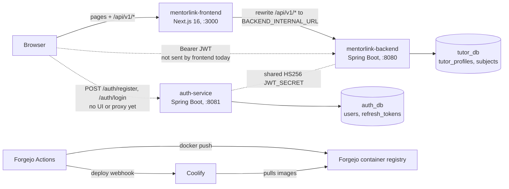
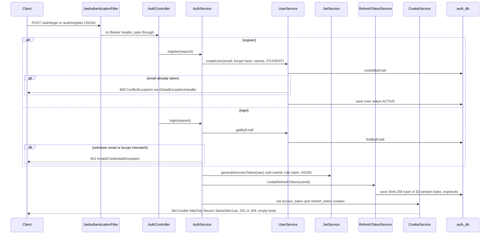
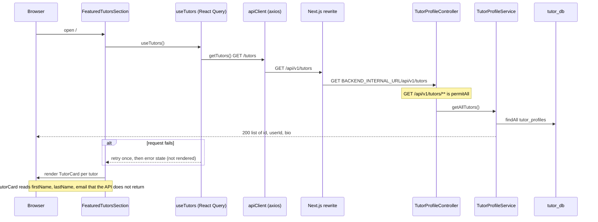
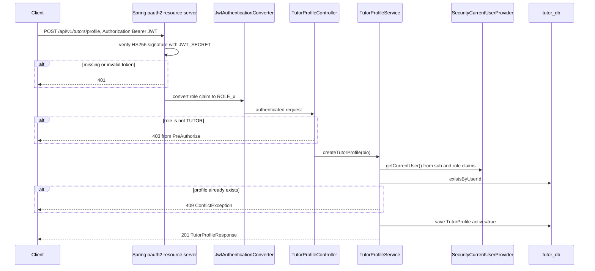
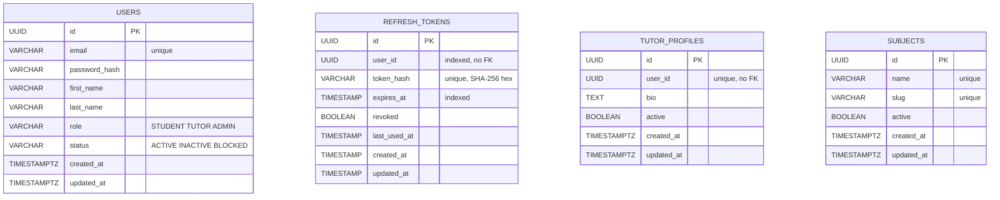

# MentorLink — Code Map of the Tutor Discovery Process

> **What it does for the business:** A visitor opens the MentorLink website and browses a list of tutors and the subjects on offer, without needing an account. Anyone can register (always as a student) or log in, and receives a short-lived session plus a longer-lived "stay signed in" credential in secure browser cookies. A signed-in tutor can publish a tutor profile with a bio, and an administrator can add new subjects to the catalogue. Today the business can rely on it for public tutor and subject listings and for account creation and login; tutor onboarding, subject administration from the website, and any booking flow are not yet usable end to end (see Risks).

**Path roots.** The repo holds three deployables. Paths in the tables are relative to:
- auth-service → `services/auth-service/src/main/java/com/sniperdev/auth_service/`
- mentorlink-backend → `services/mentorlink-backend/src/main/java/com/sniperdev/mentorlink_backend/`
- frontend → `apps/mentorlink-frontend/src/`

Paths outside those roots are given from the repo root.

## 1. Overview

A monorepo with three independently built and deployed units: **auth-service** (registration, login, JWT and refresh-token issuance), **mentorlink-backend** (the tutor-profile and subject domain, acting as an OAuth2 resource server that only validates JWTs), and a **Next.js frontend** that currently only browses tutors. Each Spring service owns its own PostgreSQL database (`auth_db`, `tutor_db`) in one shared Postgres instance. Nothing here handles bookings, payments, messaging, token refresh or logout.

## 2. High Level Architecture

Dashed edges are not exercised by code in this repo: the frontend has no login UI and no proxy to auth-service, and never attaches a token to backend calls (`lib/api/client.ts:4`). The shared-secret edge is configuration only (`JWT_SECRET` in both `application.yaml` files and `docker-compose.coolify.yml`). **auth-service and mentorlink-backend make no network calls to each other**: neither has an HTTP client (no `RestClient`, `RestTemplate`, `WebClient` or Feign), and their only coupling is that the backend verifies tokens signed with the same secret. The only service-to-service network hop in the code is frontend → backend through the Next.js rewrite.

## 3. Key flows

### 3.1 Register or log in — `POST /auth/register`, `POST /auth/login` (auth-service `auth/controller/AuthController.java:23,34`)

Invalid request bodies are rejected with 400 and per-field `validationErrors` before reaching the service (`common/exception/GlobalExceptionHandler.java:50`).

### 3.2 Browse tutors — frontend home page → `GET /api/v1/tutors`

The single-tutor page (`app/(public)/tutors/[id]/page.tsx`) follows the same path via `useTutor(id)` → `GET /api/v1/tutors/{id}`; an unknown id returns 404 from `tutors/service/TutorProfileService.java:54`.

### 3.3 Create a tutor profile — `POST /api/v1/tutors/profile` (mentorlink-backend `tutors/controller/TutorProfileController.java:25`)

`POST /api/v1/subjects` (`subjects/controller/SubjectController.java:23`) has the same shape with `hasRole('ADMIN')`, a case-insensitive name check and a generated slug (`subjects/service/SubjectService.java:27-48`).

## 4. Data model

Two separate databases; there are no foreign keys inside or across them. `user_id` columns refer to `auth_db.users.id` by convention only, so no relationships are drawn.

| Table | Database | Entity | Migration |
|---|---|---|---|
| `users` | `auth_db` | auth-service `users/model/User.java` | `services/auth-service/src/main/resources/db/migration/V1__users_table.sql` |
| `refresh_tokens` | `auth_db` | auth-service `auth/refresh/model/RefreshToken.java` | `services/auth-service/src/main/resources/db/migration/V2__refresh_tokens_table.sql` |
| `tutor_profiles` | `tutor_db` | backend `tutors/model/TutorProfile.java` | `services/mentorlink-backend/src/main/resources/db/migration/V1__create_tutor_profiles.sql` |
| `subjects` | `tutor_db` | backend `subjects/model/Subject.java` | `services/mentorlink-backend/src/main/resources/db/migration/V2__create_subjects.sql` |

Both databases are created by `docker/postgres/init/init.sql`; schemas are applied by Flyway, and Hibernate runs with `ddl-auto: validate`.

## 5. Module guide

Where each part of the codebase lives and what it is responsible for — start here to find your way around.

| Deployable | Module | Responsibility | Path |
|---|---|---|---|
| auth-service | Auth API | `/auth/register`, `/auth/login` endpoints | `auth/controller/AuthController.java` |
| auth-service | Auth orchestration | Hash password, create user, issue tokens, set cookies | `auth/service/AuthService.java` |
| auth-service | JWT | Sign and parse HS256 access tokens (`sub`, `role`) | `auth/jwt/JwtService.java`, `auth/jwt/JwtProperties.java` |
| auth-service | Refresh tokens | Generate, SHA-256 hash and persist refresh tokens; write cookies | `auth/refresh/` |
| auth-service | Request auth | Bearer-header filter that loads the user into the security context | `auth/security/JwtAuthenticationFilter.java` |
| auth-service | Users | User entity, role and status enums, lookup and creation | `users/` |
| auth-service | Config | Security chain, BCrypt encoder, JPA auditing, JWT properties | `config/` |
| auth-service | Errors | `ApiError` body and exception → status mapping | `common/exception/` |
| backend | Tutors | Tutor-profile API, service, mapper, entity, repository | `tutors/` |
| backend | Subjects | Subject catalogue API, slug generation, entity, repository | `subjects/` |
| backend | Security | Resource-server chain, JWT decoder, role converter, current-user lookup | `security/` |
| backend | Config | CORS, OpenAPI metadata, JPA auditing | `config/` |
| backend | Errors | `ApiError` body and exception → status mapping | `common/exception/` |
| frontend | Routes | App Router pages: home and tutor detail | `app/(public)/` |
| frontend | Home sections | Hero, search (static), featured-tutors list | `features/home/sections/` |
| frontend | Tutors feature | API calls, React Query hooks, card, types | `features/tutors/` |
| frontend | Infrastructure | axios client, query client and keys | `lib/`, `providers/QueryProvider.tsx` |
| frontend | UI kit | shadcn/ui primitives and navbar | `components/` |
| repo | CI/CD | Test, build, push image, trigger Coolify per deployable | `.forgejo/workflows/` |
| repo | Runtime | Local Postgres only; full stack for Coolify | `docker-compose.yml`, `docker-compose.coolify.yml` |

## 6. Entry points

| Entry point | Trigger / access | Where |
|---|---|---|
| `POST /auth/register` | Public; sets `access_token` and `refresh_token` cookies, 201 | auth-service `auth/controller/AuthController.java:23` |
| `POST /auth/login` | Public; sets cookies, 204 | auth-service `auth/controller/AuthController.java:34` |
| `GET /actuator/health` (both services) | Public | `config/SecurityConfig.java:32`, `security/SecurityConfiguration.java:38` |
| `GET /api/v1/tutors` | Public | backend `tutors/controller/TutorProfileController.java:32` |
| `GET /api/v1/tutors/{id}` | Public | backend `tutors/controller/TutorProfileController.java:37` |
| `POST /api/v1/tutors/profile` | Bearer JWT, `ROLE_TUTOR` | backend `tutors/controller/TutorProfileController.java:25` |
| `GET /api/v1/subjects` | Public | backend `subjects/controller/SubjectController.java:30` |
| `GET /api/v1/subjects/{id}` | Public | backend `subjects/controller/SubjectController.java:35` |
| `POST /api/v1/subjects` | Bearer JWT, `ROLE_ADMIN` | backend `subjects/controller/SubjectController.java:23` |
| Swagger UI / OpenAPI docs | springdoc defaults; not in `permitAll`, so authenticated (inference) | backend `config/OpenApiConfig.java` |
| `/` and `/tutors/[id]` pages | Browser | frontend `app/(public)/page.tsx`, `app/(public)/tutors/[id]/page.tsx` |
| `/api/v1/*` proxy | Next.js rewrite to `BACKEND_INTERNAL_URL` | `apps/mentorlink-frontend/next.config.ts` |
| CI workflows | Push to `main` or PR touching the deployable's folder, or manual | `.forgejo/workflows/{auth,backend,frontend}.yml` |

No scheduled jobs and no messaging listeners exist.

## 7. Tech stack

| Technology | Version | Used for |
|---|---|---|
| Java | 21 | Both Spring services (`pom.xml`, Temurin images) |
| Spring Boot | 4.0.7 | Web MVC, Security, Data JPA, Validation, Actuator, Flyway |
| Spring Security OAuth2 Resource Server | Boot-managed | JWT validation in mentorlink-backend |
| JJWT | 0.13.0 | Token signing and parsing in auth-service |
| springdoc-openapi | 3.0.2 | Swagger UI for mentorlink-backend |
| Flyway (+ postgresql module) | Boot-managed | Schema migrations |
| PostgreSQL | 17 (image) | `auth_db`, `tutor_db` |
| H2 | Boot-managed | In-memory DB for tests (`application-test.yaml`) |
| Lombok | Boot-managed | Entities and DTO boilerplate |
| Next.js | 16.2.10 | Frontend, standalone output, API rewrite |
| React | 19.2.4 | UI |
| TanStack React Query | ^5.101.2 | Server-state caching (5 min stale, 1 retry) |
| axios | ^1.18.1 | HTTP client |
| Tailwind CSS, shadcn, Base UI | ^4, ^4.13.0, ^1.6.0 | Styling and UI primitives |
| zod | ^4.4.3 | Declared dependency; no usage found in `src/` |
| pnpm | 12.18.0 | Frontend package manager |
| Node | 22 (alpine image) | Frontend build and runtime |
| Forgejo Actions, Coolify | n/a | CI, image registry, deployment |

## 8. Risks & known issues

| # | Risk | Consequence | Where |
|---|---|---|---|
| 1 | **Token transport mismatch.** auth-service returns tokens only as httpOnly cookies, but mentorlink-backend's resource server reads only the `Authorization: Bearer` header, and the frontend never sends credentials. | No browser client can call the protected backend endpoints with the tokens it receives; `POST /tutors/profile` and `POST /subjects` are unusable from the web app. | `auth/refresh/service/CookieService.java:18-66`, backend `security/SecurityConfiguration.java:41`, `lib/api/client.ts:4` |
| 2 | **Frontend/backend tutor contract drift.** Frontend `TutorSummary` expects `email`, `firstName`, `lastName`; backend returns `id`, `userId`, `bio`. | As soon as one tutor profile exists, `TutorCard` evaluates `tutor.firstName[0]` on `undefined` and the home page crashes; the detail page renders blank names. | `features/tutors/types/tutor.ts:1`, `features/tutors/components/TutorCard.tsx:24`, backend `tutors/dto/TutorSummaryResponse.java:5` |
| 3 | **No way to become TUTOR or ADMIN.** Registration always assigns `STUDENT`, no code changes a role, and no migration, seed file or startup runner creates privileged accounts. | Nobody can use tutor-profile or subject creation until some out-of-band provisioning exists; recreating the database loses any accounts made by hand. | auth-service `auth/service/AuthService.java:37`, `db/migration/` (schema only), `docker/postgres/init/init.sql` (databases only) |
| 4 | **Account status ignored at login.** `login` checks only the password; `BLOCKED` and `INACTIVE` users still receive tokens. | Blocking a user has no effect. | auth-service `auth/service/AuthService.java:44-53` |
| 5 | **Refresh tokens are write-only.** Tokens are stored on every login/register, but there is no refresh or logout endpoint, and `findByTokenHash`/`deleteByUserId` are never called. | Sessions end hard after the 15-minute access token; `refresh_tokens` grows without bound and revocation is impossible. | `auth/refresh/service/RefreshTokenService.java:22`, `auth/refresh/repository/RefreshTokenRepository.java:13-15` |
| 6 | **Exception thrown inside the auth-service filter.** A valid JWT for a user that no longer exists makes `getUserById` throw `InvalidCredentialsException` in a servlet filter, outside `@RestControllerAdvice`. | Likely a 500 instead of 401, including on public `/auth/**` calls that carry a stale header (inference, not tested). | `auth/security/JwtAuthenticationFilter.java:53`, `users/service/UserService.java:47` |
| 7 | **Symmetric shared secret.** Both services hold the same HS256 `JWT_SECRET`. | Anyone with access to the backend's config can mint tokens for any user and role; the two services cannot rotate keys independently. | auth `auth/jwt/JwtService.java:49`, backend `security/JwtConfiguration.java:23` |
| 8 | **Subject name normalisation is inconsistent.** Duplicate check uses the trimmed name but the untrimmed name is saved; the slug replaces single spaces only; concurrent creates hit the DB unique constraint with no handler. | Stored names may carry stray whitespace, slugs like `math--101`, and races return 500. | backend `subjects/service/SubjectService.java:29-46,63` |
| 9 | **Dead or misleading config.** `JwtAuthenticationConverterConfiguration` has no `@Bean` (never used); auth-service's `spring.application.name` is `mentorlink-backend`; `refresh_tokens` uses `TIMESTAMP` while other tables use `TIMESTAMPTZ`. | Confusing logs/metrics attribution, and timezone-dependent expiry comparisons. | backend `security/JwtAuthenticationConverterConfiguration.java:15`, `services/auth-service/src/main/resources/application.yaml:6`, `V2__refresh_tokens_table.sql:6` |
| 10 | **Null role claim → 500.** `UserRole.valueOf(null)` in the current-user lookup. | A token without `role` passes authentication and fails with a 500 in the service layer. | backend `security/SecurityCurrentUserProvider.java:19` |
| 11 | **Hard-coded CORS origin and no auth proxy.** Backend allows only `http://localhost:3000`; auth-service has no CORS and the frontend has no rewrite for `/auth`. | A future login UI cannot reach auth-service from the browser without proxy or CORS work. | backend `config/WebConfig.java:13`, `apps/mentorlink-frontend/next.config.ts` |
| 12 | **`Secure` cookies on a plain-HTTP LAN deployment.** Both auth cookies are always `Secure` with `SameSite=Lax` and no `Domain`. | Browsers drop `Secure` cookies set over `http://` on a LAN address (localhost is usually exempt), so login over plain HTTP on the LAN would set no cookies. Whether the LAN deployment uses HTTPS is open (section 9). | auth-service `auth/refresh/service/CookieService.java:53-60` |
| 13 | **Conflicting frontend build-arg defaults.** CI builds the image with `NEXT_PUBLIC_API_URL=/api/v1`, but `docker-compose.coolify.yml` defaults the same build arg to `http://localhost:18081/api/v1`. `NEXT_PUBLIC_*` is inlined into the browser bundle at build time. | Depending on which path Coolify uses to build, browsers either use the same-origin proxy or call `localhost:18081`, which fails from any other LAN machine. Changing the value at container runtime has no effect on the browser bundle. | `.forgejo/workflows/frontend.yml` (build step), `docker-compose.coolify.yml` (`frontend.build.args`), `apps/mentorlink-frontend/Dockerfile` |

Inventory flagged no swallowed exceptions, TODO/FIXME markers or disabled tests. Test posture: 5 test classes per Spring service (controller, service, JWT filter integration); the frontend has none, and CI runs `pnpm lint` and `pnpm build` only. The Spring Dockerfiles run `mvnw verify` again inside the image build, so tests run twice per pipeline.

## 9. Deployment & environment

The deployment is a local/LAN development and testing environment managed by Coolify. It is not meant to be public. This section describes that environment as it is now; it is not a target architecture. Each statement is labelled:

- **Verified:** read from a file in this repo.
- **Reported:** the owner's description, which the repo cannot confirm.
- **`open`:** needs inspection of the live Coolify configuration.

### 9.1 Current state

| Area | Status | Statement | Evidence |
|---|---|---|---|
| Topology | Verified | Three containers (frontend, backend, auth-service) plus `postgres` (one instance, `auth_db` and `tutor_db`) on the bridge network `mentorlink`. | `docker-compose.coolify.yml`, `docker/postgres/init/init.sql` |
| Topology | Reported | Coolify manages the deployment, which is used only on the local network. | Owner |
| Service-to-service traffic | Verified | Frontend → backend via the Next.js rewrite to `BACKEND_INTERNAL_URL`. Backend and auth-service do not talk to each other; they share only `JWT_SECRET`. | `apps/mentorlink-frontend/next.config.ts`, no HTTP client in either Spring service |
| Deploy path | Verified | CI builds and pushes three images (`mentorlink-auth`, `mentorlink-backend`, `mentorlink-frontend`) to `forgejo.home.sniperlab.uk` and calls a **separate** Coolify webhook for each. | `.forgejo/workflows/*.yml` |
| Deploy path | `open` | Whether Coolify runs those CI-built images as three separate resources (suggested by the three webhooks; inference) or builds from `docker-compose.coolify.yml`, which has `build:` contexts and no `image:` references. The effective build args depend on the answer. | Coolify resource settings |
| Auth exposure | Verified (compose file only) | `docker-compose.coolify.yml` publishes auth-service on host port `${AUTH_PORT:-18082}`, the backend on `${BACKEND_PORT:-18081}` and the frontend on `${FRONTEND_PORT:-18080}`, so with that file auth-service is directly reachable on the host. | `docker-compose.coolify.yml` |
| Auth exposure | Verified | The frontend does **not** proxy `/auth`: the only rewrite is `/api/v1/:path*` → backend, and there is no middleware or auth code in the frontend. | `apps/mentorlink-frontend/next.config.ts` |
| Auth exposure | `open` | Auth hostname or path in the running deployment, whether Coolify's proxy exposes it on a domain, and whether the LAN deployment is served over HTTPS. | Coolify proxy / domain settings |
| Cookies | Verified | `access_token` and `refresh_token` are `HttpOnly`, `Secure`, `SameSite=Lax`, `Path=/`, host-only (no `Domain`). The backend ignores cookies and reads only `Authorization: Bearer`. | `CookieService.java:53-60`, backend `SecurityConfiguration.java:41` |
| API URL: `NEXT_PUBLIC_API_URL` | Verified | **Build-time** value, inlined into the browser bundle. CI image is built with `/api/v1`; Dockerfile default `/api/v1`; `docker-compose.coolify.yml` default `http://localhost:18081/api/v1`. | `frontend.yml`, `Dockerfile`, `docker-compose.coolify.yml` |
| API URL: `BACKEND_INTERNAL_URL` | Verified | Server-side, read in `rewrites()` with fallback `http://mentorlink-backend:8080`; the Dockerfile sets the same default as a build arg and CI does not override it. It resolves through the compose service name `mentorlink-backend`. | `next.config.ts`, `Dockerfile` |
| API URL: `BACKEND_INTERNAL_URL` | Inference | With `output: "standalone"`, Next.js evaluates `rewrites()` at build time, so changing this variable at container runtime probably has no effect. Not tested here. | Next.js behaviour |
| API URLs in the running deployment | Reported, `open` | The owner believes the values are `/api/v1` and `http://mentorlink-backend:8080`. That matches the CI-built image but not the compose default for `NEXT_PUBLIC_API_URL`. The live Coolify values are not verified. | Coolify environment / build settings |
| Secrets | Verified | `JWT_SECRET` and `POSTGRES_PASSWORD` are plain environment variables. Compose fails fast if either is missing (`:?`), and `JWT_SECRET` has no default in either `application.yaml`. The local `docker-compose.yml` hard-codes the dev database password, which is fine for local use only. | `docker-compose.coolify.yml`, both `application.yaml`, `docker-compose.yml` |
| Secrets | Verified | No `.env` or `.env.example` file exists (they are gitignored). Forgejo CI secrets cover only `REGISTRY_TOKEN`, `COOLIFY_TOKEN` and the three webhook URLs; CI never handles `JWT_SECRET` or `POSTGRES_PASSWORD`. | `.gitignore`, `.forgejo/workflows/*.yml` |
| Secrets | Reported, `open` | Coolify injects the variables at deploy time. Where they are stored in Coolify and who can read them are unverified. | Coolify environment settings |
| Secret rotation | `open` | No rotation procedure is documented in the repo, and the owner knows of none. | Owner |
| Privileged accounts | Verified | No migration, seed SQL or startup runner creates TUTOR or ADMIN users; registration always creates STUDENT. How such accounts are made today is unknown, and nothing in the repo shows manual SQL. | `AuthService.java:37`, `db/migration/`, `init.sql` |

### 9.2 Known gaps (current state)

1. **Privileged-user provisioning does not exist.** There is no repeatable way to get a TUTOR or ADMIN account, so the protected backend flows cannot be exercised after a fresh database.
2. **The auth flow cannot complete from a browser.** Tokens are delivered as cookies that the backend does not read (Risk 1), there is no route from the frontend origin to auth-service, and `Secure` cookies may be dropped over plain HTTP (Risk 12).
3. **The build-time API URL is ambiguous.** Two defaults conflict, and the effective value depends on which build path Coolify uses (Risk 13).
4. **Secret ownership is unrecorded.** Neither the repo nor the owner can say where the secrets live or how to rotate them, and one HS256 secret is shared by both services (Risk 7).
5. **Service ports may be reachable from the LAN.** The compose file publishes all three services on host ports. Whether the LAN deployment uses TLS is unknown.

### 9.3 Future architecture recommendations

These are recommendations, not current requirements, and none is implemented today.

| Area | Recommendation |
|---|---|
| Service-to-service security | Replace the shared HS256 secret with an asymmetric key pair. auth-service signs with RS256 or ES256 and publishes a JWKS endpoint, and the backend validates with `NimbusJwtDecoder.withJwkSetUri`. The backend can then no longer mint tokens, and keys can rotate via `kid`. Add `iss` and `aud` claims and validate them. If direct calls between services are added later, keep them on the internal network and authenticate them (mTLS or client-credential tokens). |
| Auth exposure and cookies | Serve the frontend, `/api/v1` and `/auth` from **one origin** through a reverse proxy or a Next.js rewrite. Cookies then stay first-party with `SameSite=Lax`/`Strict`, and CORS is unnecessary. Choose one token transport: either the backend reads the access-token cookie (with a CSRF defence), or the frontend sends a Bearer header. Add `/auth/refresh` (rotate and revoke) and `/auth/logout`. Terminate TLS even on the LAN, or make `Secure` configurable per environment. Expose only the frontend/proxy port, not the service ports. |
| Environment-specific API routing | Keep `NEXT_PUBLIC_API_URL` a relative `/api/v1` everywhere so the browser bundle needs no per-environment rebuild, and remove the conflicting compose default. Make `BACKEND_INTERNAL_URL` truly runtime, using middleware or a route handler instead of build-time `rewrites()`, or document that it requires a rebuild. Move the CORS origin into configuration. |
| Dev/test account provisioning | Add a repeatable, environment-gated seed: for example a Flyway location such as `db/seed-dev` enabled only by a `dev`/`test` profile, or an `ApplicationRunner` behind `@Profile("dev")` that creates TUTOR and ADMIN users from env-provided credentials. Recreating the database then recreates the accounts. Keep it out of production, and add a proper admin role-management endpoint separately. |
| Secret management and rotation | Record a single source of truth for each secret (Coolify environment as an interim, later a secret manager such as Vault or SOPS-encrypted files). Commit a `.env.example` with names only. Use a separate database user and password per service instead of one shared `mentorlink` login. Document rotation. With JWKS, rotation becomes "publish new `kid`, sign with it, retire the old key after the token TTL". |

## 10. Contacts & source

- **Owner:** no `catalog-info` or CODEOWNERS file. OpenAPI contact: "Sniperdev" (`backend config/OpenApiConfig.java`).
- **Main committers (all-time):** sniperdev (42), Igor Spychała (1).
- **Source:** `/home/igor/IdeaProjects/mentorlink`
- **Remote:** `ssh://git@git.home.sniperlab.uk:222/sniperdev/mentorlink.git`
- **Branch:** `docs/architecture-discovery`
- **Commit:** `25c56f110a703adf584a3912ce30e0bbc6c5eca7` (2026-11-11)
- **Generated:** 2026-11-11

> ⚠️ **Not determined from these sources**
>
> | Gap | Why it is open | Where the answer likely lives |
> |---|---|---|
> | `open`: Auth hostname/path, LAN exposure and HTTPS in the running deployment | The repo shows only compose port mappings and no frontend proxy for `/auth`; Coolify's proxy may add a domain | Coolify proxy and domain settings for auth-service |
> | `open`: Whether Coolify runs the CI images or builds `docker-compose.coolify.yml` | Three per-service webhooks suggest separate image resources, but the compose file uses `build:` | Coolify resource type and settings |
> | `open`: Effective `NEXT_PUBLIC_API_URL` and `BACKEND_INTERNAL_URL` | The owner reports `/api/v1` and `http://mentorlink-backend:8080`; the compose default conflicts; both are fixed at build time | Coolify build args and environment for the frontend |
> | `open`: Whether auth cookies are accepted by browsers on the LAN | They are `Secure`, so this depends on whether the LAN deployment uses HTTPS | Coolify proxy / TLS settings |
> | `open`: How TUTOR/ADMIN accounts are created today, if at all | No provisioning exists in the repo; the owner reports no mechanism | Owner; tracked as a gap in section 9.2 |
> | `open`: Where `JWT_SECRET` and `POSTGRES_PASSWORD` are stored, and their rotation procedure | Plain env vars, not in the repo or in CI secrets; the owner believes Coolify injects them | Coolify environment variables for each resource |
